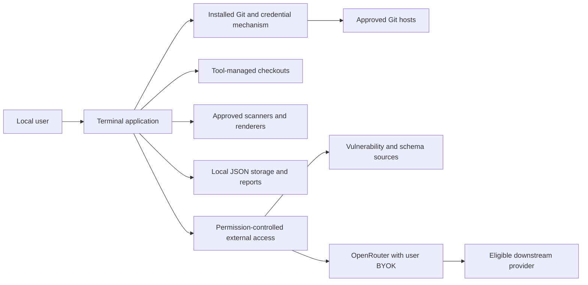
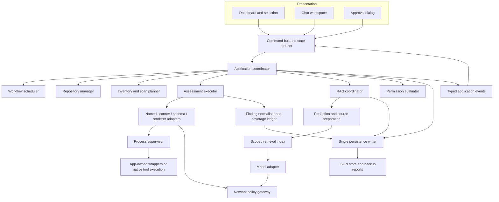
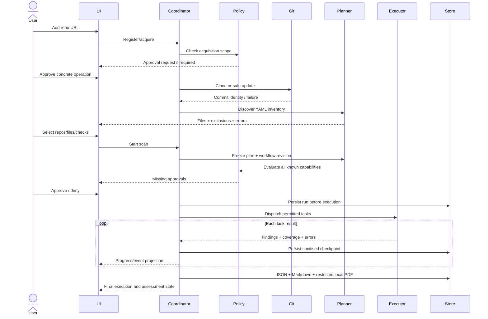
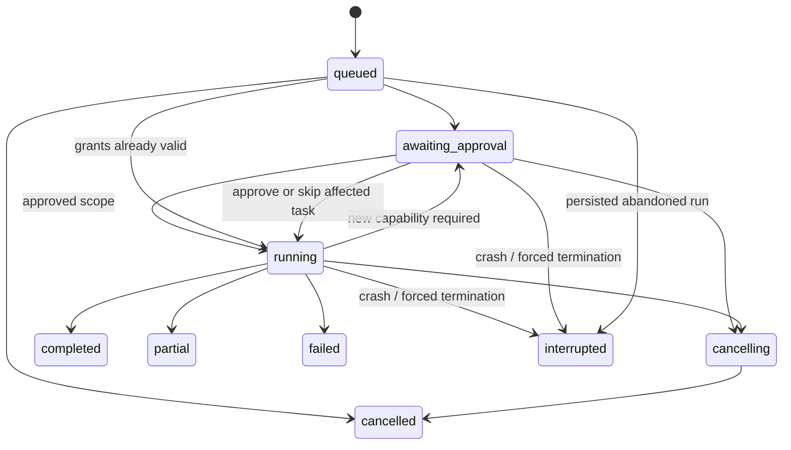
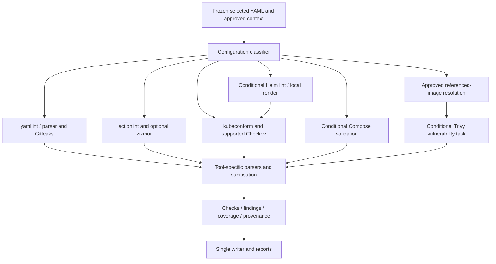
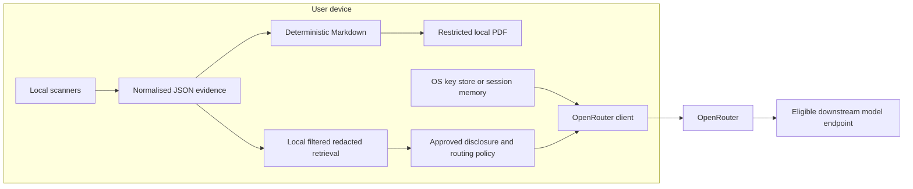
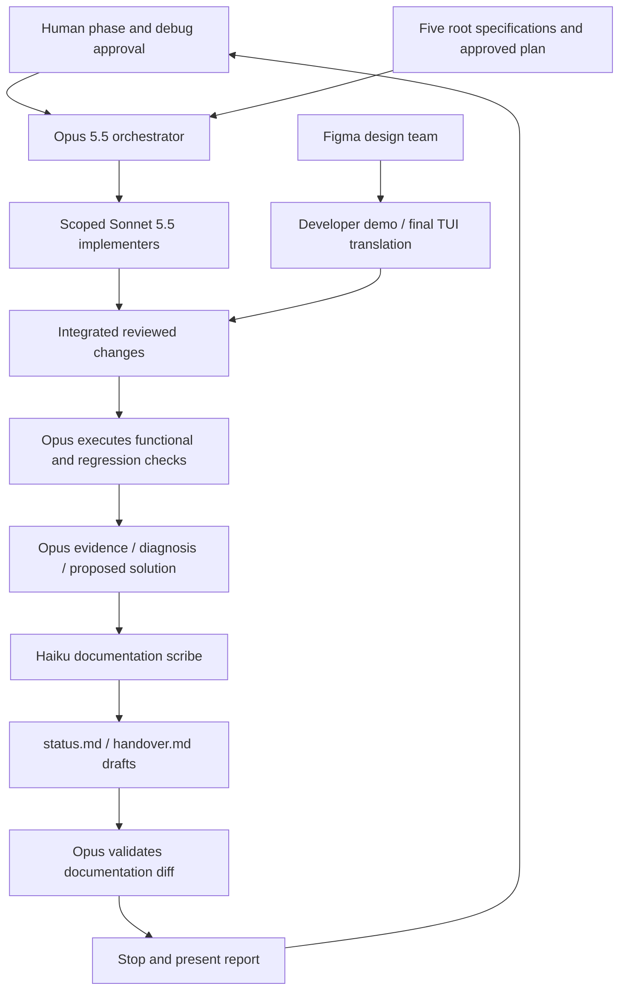

# PWT YAML Security Workbench — Architecture

Consolidated revision 0.3. Includes all decisions through 23 October 2026: OpenRouter BYOK; local JSON/Markdown/PDF; named tool and wrapper plan; one core developer plus a Figma design team; Opus-led verification, Sonnet implementation, Haiku documentation and owner-approved debug cycles. This specification is not evidence of implemented code or completed tests. Earlier v0.1/v0.2 wording is superseded by this consolidated set.

Version: 0.3.3 (amendments CA-01, CA-02; store contract 1.3, wrapper protocol 1.1) | Date: 2026-10-23 | Status: Proposed architecture
Scope: Single-user local application; Rust-oriented reference design, subject to language sign-off.

## 1. Architectural intent

Use a modular monolith with an event-driven terminal UI, a bounded assessment coordinator, JSON persistence, capability-gated external integrations and an optional RAG subsystem. External scanners are supervised subprocesses, not separate product microservices. The core must remain useful if every AI service is unavailable.

## 2. System context



Trust boundaries:

1. Repository content, remote schemas/docs and scanner outputs are untrusted input.
2. Git credentials remain outside application-owned persistence.
3. App-owned storage may contain sensitive repository metadata even after secret redaction.
4. Network/provider access crosses a disclosure boundary requiring explicit scope.
5. Models produce untrusted advisory text; they do not control permission grants or execution.

## 3. Component architecture



Every network/process operation must be authorised before execution. Adapters that perform their own network I/O must expose/enforce equivalent policy; merely drawing a gateway does not constrain their internal traffic.

## 4. Ownership and interfaces

| Component | Owns | Must not own |
|---|---|---|
| UI | Focus/layout/input, projections of app state | Git execution, scanner business logic, direct data-file writes |
| Coordinator | Use-case sequencing, active run ownership | Raw terminal rendering |
| Scheduler | Due-time evaluation while app is alive | Background services, implicit catch-up scans |
| Repo manager | Managed checkout identity, locks and safe Git invocation | Credential storage, force-reset behaviour |
| Planner | Frozen target list, capability tasks, approvals needed | Claims that unsupported checks passed |
| Executor | Bounded task execution, cancellation, outcomes | UI state or unrestricted command strings |
| Permission evaluator | Scope matching, grant/deny/revoke records | Model-authored approvals |
| Normaliser | Finding IDs, source attribution, redaction and coverage | Invented locations or scanner evidence |
| RAG coordinator | Context selection, retrieval and provider requests | File modification or command execution |
| Persistence writer | Validation, serialised writes, recovery, exports | Security decisions based on filenames alone |

Core domain types: RepoId, FileId, WorkflowId, RunId, TaskId, FindingId, ApprovalId, ConversationId, ChunkId, SourceRef, CheckOutcome and ExecutionStatus. Prefer typed IDs over interchangeable strings in Rust internals.

## 5. End-to-end manual assessment sequence



Denied tasks do not become passes. Dynamic discoveries that introduce new network scope pause at a new approval boundary.

## 6. Runtime model

- One main application process owns the terminal and scheduler.
- UI rendering/input and asynchronous work communicate over bounded typed channels.
- Git/scanner/render processes are children tracked by run/task IDs.
- Blocking parse/filesystem workloads run outside the UI event path.
- One persistence writer serialises authoritative changes.
- One exclusive lock prevents multiple app instances writing the same store; a read-only second-instance mode may be considered later.
- Per-repo locks prevent app-owned updates overlapping assessment.
- Terminating the parent must not leave unattended assessment intentionally running; platform-specific child-tree cleanup is a release test.

### Canonical application command/event contract (app contract v1.0, CA-01)

This section is the single canonical command/event vocabulary (resolves C4/C5). UI Schema §17, the demo TUI and mocks refer to it; on conflict this section wins. The contract has its own version line (`app_contract_version` 1.0), independent of the document revision, store schema v1.3, wrapper protocol v1.1 and UI schema v1.0. Commands are typed requests from the UI reducer to the coordinator; events are typed projections back. Field-level DTOs are defined in code during P01 and reviewed as a shared contract.

Status: **pilot** = command/event is implemented in the pilot. **reserved (deferred)** = name and intent reserved so later work does not invent a conflicting interface; it is not implemented, is not shown as available in the UI and returns an explicit `OperationFailed{code="deferred"}` if dispatched.

| Command | Status | Purpose / requirement |
|---|---|---|
| AddRepository | pilot | Validate URL, register, request acquisition approval (REP-01) |
| RefreshRepository | pilot | Clone if absent, otherwise fast-forward update under lock (REP-02, REP-05) |
| RemoveRepository | pilot | Deregister with explicit choices for checkout deletion, derived-index purge and report retention (Data §14) |
| DiscoverFiles | pilot | Re-inventory a repository (DISC-01–DISC-05) |
| UpdateSelection | pilot | Apply tristate/selector changes (DISC-03) |
| ReviewScanPlan | pilot | Build and freeze a reviewable plan, list required approvals |
| StartScan | pilot | Execute a reviewed plan |
| CancelRun | pilot | Request supervisor cancellation of a run (WF-05) |
| SaveWorkflow | pilot | Create/update a workflow; increments revision (WF-01) |
| DeleteWorkflow | pilot | Remove a workflow definition; history retained |
| SetWorkflowEnabled | pilot | Enable/disable app-open triggers (WF-02) |
| RunWorkflow | pilot | Manual run of a saved workflow |
| ResolveApproval | pilot | Approve once / approve workflow scope / deny a pending request |
| RevokeApproval | pilot | Revoke an existing grant (Approval state machine) |
| ConfigureCredential | pilot | Set, validate, replace or delete the BYOK key (session-only; OS store if verified) (KEY-01) |
| ConfigureProvider | pilot | Set explicit model ID and optional provider allowlist (KEY-02) |
| SetChatContext | pilot | Choose repo/run/finding context for retrieval (RAG-01, RAG-07) |
| SendChatMessage | pilot | Retrieve, redact, request approval if needed, send (RAG) |
| CancelChatResponse | pilot | Stop an in-flight streamed response |
| ExportReport | pilot | Locate/open-path information for an existing report export (no external open) |
| RegenerateExport | pilot | Re-derive a failed/missing Markdown or PDF from retained JSON without rescanning (RES-08) |
| InspectDependencies | pilot | Re-run preflight and refresh `tools.json` view (TOOL-01) |
| RequestShutdown | pilot | Cancel work, persist, restore terminal |
| SuppressFinding / UpdateSuppression | reserved (deferred) | RES-06 suppression/baseline |
| CompareRuns | reserved (deferred) | History comparison with scope-compatibility warnings |
| GenerateReportNarrative | reserved (deferred) | Optional cited AI narration as a new/versioned report (RES-07) |
| PersistConversation | reserved (deferred) | Opt-in sanitised chat history |
| StartLiveVerification | reserved (deferred) | SCAN-06 non-mutating verification |

| Event | Status | Delivery |
|---|---|---|
| RepositoryRegistered, RepositoryRemoved | pilot | must-deliver |
| RepositoryStatusChanged | pilot | must-deliver; carries clone/update started/succeeded/failed/skipped state (replaces RepoUpdateStarted/RepoUpdateFailed) |
| InventoryUpdated | pilot | must-deliver |
| SelectionChanged | pilot | latest-value (intermediate states may be coalesced) |
| WorkflowSaved, WorkflowDeleted, WorkflowStateChanged | pilot | must-deliver |
| TriggerFired, TriggerSkipped | pilot | must-deliver (overlap/missed reasons) |
| RunPlanned, RunStarted | pilot | must-deliver |
| RunStateChanged | pilot | must-deliver; includes `cancelling` and `awaiting_approval` transitions (replaces RunCancelling) |
| TaskStarted, CheckCompleted | pilot | must-deliver |
| TaskProgress | pilot | coalescible |
| FindingObserved | pilot | must-deliver |
| RunFinished | pilot | must-deliver; terminal execution/assessment/coverage (replaces RunFinalised) |
| ApprovalRequested, ApprovalResolved, ApprovalRevoked | pilot | must-deliver |
| ReportWritten | pilot | must-deliver; per-format JSON/MD/PDF status |
| ExportStatusChanged | pilot | must-deliver; regeneration outcome |
| DependencyStatusChanged | pilot | must-deliver |
| CredentialStatusChanged | pilot | must-deliver; never contains key material |
| ChatRetrievalCompleted | pilot | must-deliver; selected source IDs only (replaces ChatRetrievalStarted) |
| ChatResponseStarted, ChatResponseFinished | pilot | must-deliver; finish carries completed/cancelled/incomplete (replaces ChatCompleted) |
| ChatResponseChunk | pilot | coalescible by merging text, never dropping it (replaces ChatTokenReceived) |
| ChatFailed | pilot | must-deliver; typed reason (invalid key, credits, rate limit, no compliant route, timeout, truncation, provider outage — the last added 2026-10-26 by owner acceptance at P01-T09, from UI Schema §15; app contract 1.0 unchanged as no implementation had been released) |
| StorageFailure, OperationFailed | pilot | must-deliver |
| SuppressionChanged, RunComparisonReady | reserved (deferred) | — |

Persisted `log.json` events use these names in `event_type`; mock events in the demo TUI carry a visible mock marker and cannot satisfy real-scan acceptance.

No event includes raw secret values or raw child-process output. Progress can be coalesced; findings, permission decisions and terminal run states cannot be silently dropped.

## 7. State machines

### Run execution



`completed` describes execution, not a clean security outcome. `partial` means useful results exist but coverage was lost; `failed` means assessment produced no usable target coverage. Graceful cancellation is `cancelled`; abnormal termination is `interrupted` after recovery.

### Check outcome

`pending -> running -> passed | findings | failed | unsupported | skipped | incomplete | cancelled`.

A task can produce findings and still fail later: retain findings and mark its check outcomes incomplete as appropriate. Final assessment summary is `findings`, `no_findings` or `unknown`; coverage is a separate `complete`, `partial` or `none` field. Display full qualification even if findings exist.

### Approval

`pending -> approved | denied | cancelled`. Approved grants may later be revoked or expire. An operation is permitted only while its exact relevant constraints match a valid grant.

## 8. Scope, provenance and generated artifacts

A run stores an immutable snapshot of selected repository refs, commit IDs, file paths/digests, categories, settings, dependency versions and workflow revision. File identity is repository plus relative path; content identity is digest plus commit context.

Source files and generated artifacts are distinct entities. A rendered artifact can point to several source/value inputs. Only record exact source mappings supplied by the renderer; otherwise show the generated location and input provenance without claiming an exact source line.

External references have origin, resolved identity/digest, retrieval time and approval ID. Reference cycles/depth/size limits yield coverage gaps.

## 9. RAG data path

```mermaid
flowchart LR
  S[Explicit repo / run / finding context] --> E[Eligible source resolver]
  E --> R[Secret redaction and control-character sanitisation]
  R --> C[Chunking with provenance]
  C --> I[Local retrieval index]
  I --> F[Context filter + ranking + token budget]
  F --> P[Disclosure policy / approval]
  P --> OR[OpenRouter BYOK]
  OR --> M[Approved eligible inference endpoint]
  M --> O[Answer with validated citation identifiers]
  O --> U[Chat panel / evidence navigation]
```



Requirements:

- Filter by allowed context before ranking.
- Local lexical retrieval is a proposed baseline. An embedding backend is optional and independently approved.
- Index only redacted content; separate caches by repo/commit/redaction version.
- Repository removal can purge associated chunks and conversations according to explicit retention choice.
- Never expose execution or file-write tools to the model.
- Validate citation references against retrieved source IDs; flag unsupported assertions rather than manufacturing citations.
- Stale history remains available for explicit historical questions, with stale badges.
- Chat availability cannot determine scan availability.

## 10. Permission architecture

A permission request contains capability, operation summary, arguments fingerprint, workflow revision, target repos, destinations/resources, data categories, purpose and requested lifetime. A grant cannot be inferred from a conversational answer or repository content.

Initial clone requires its own concrete approval before any workflow exists. Approved saved workflows reuse only their authorised operations. Denied live/network checks remain visible in coverage. Redirects, recursive references and scanner-controlled downloads must not escape policy.

No unrestricted secret verification: an adapter must not submit detected secret values to external services. Existing Git credentials are used only by approved Git operations.

## 11. Storage and consistency

```text
<app-data>/
  config.json
  repo.json
  workflows.json
  approvals.json
  log.json
  tools.json                   # preflight/manifest view; application-owned, not executable config
  suppressions.json            # reserved (RES-06 deferred); not written by the pilot
  .app.lock
  checkouts/<repo-id>/...
  backup/<utc-time>_<repo-slug>_<run-id>.json
  backup/<utc-time>_<repo-slug>_<run-id>.md
  backup/<utc-time>_<repo-slug>_<run-id>.pdf
  rag/index.json
  rag/conversations.json       # sanitised persistence only if enabled
  cache/...                    # approved sanitised/cache material
  tmp/...                      # bounded generated artifacts, cleaned safely
```

Directory root is resolved by the platform application-data mechanism or explicit user configuration. No exact OS path is assumed here. User-facing backup directory can be relocated by configuration.

- No cross-file transaction guarantee. Persist run lifecycle before tasks and final report identity after finalisation.
- JSON report is authoritative assessment evidence. Deterministic Markdown and restricted local PDF derive from the same evidence; optional AI narrative is labelled.
- Persist independent JSON/Markdown/PDF export outcomes; regenerate failed derived formats without rerunning assessment.
- Startup reconciles logs with reports and marks abandoned runs interrupted.
- Incomplete writes never overwrite the only validated copy; use validated replacement/recovery handling tested per OS.
- Workflow updates increment revision and invalidate affected grants, without mutating old run snapshots.

## 12. Failure and recovery design

| Failure | Behaviour |
|---|---|
| Git auth/update failure | Sanitised actionable message; skip repo; continue others |
| Missing scanner | Unsupported capability, dependency guidance, no clean badge |
| Scanner timeout/crash | Preserve earlier findings; failed/incomplete task |
| Scanner output exceeds budget | Reader stops at budget, immediate termination; output marked truncated; check incomplete, never passed (CA-02) |
| Leftover descendants after child exit | Group members cleaned up and recorded separately from the child's own status (CA-02); descendants outside the group remain a stated limitation |
| Invalid schema/renderer missing inputs | Specific gap; other applicable checks continue |
| Approval denied | Skip affected operation; qualified summary |
| Terminal resize | Reflow layout; preserve app/run state |
| Storage full/permission denied | Prominent error; stop starting new tasks if durable evidence cannot be preserved |
| Model unavailable | Chat error only; scans remain usable |
| Forced termination | Reconcile orphaned runs/reports at next startup |
| External API rate limit | Bounded retry only for safe operations; preserve failure context |

## 13. Security boundaries and limitations

- Read-only assessment is policy plus implementation discipline, not a guarantee supplied by Rust or an ordinary child process.
- Fixed binary/argument policies and app-owned temporary output are mandatory. Stronger OS sandboxing is a separate hardening decision.
- Repositories may contain malicious Git configuration inputs, templates, control characters or oversized data. Clone/render/parser safety requires targeted tests.
- Escape terminal control sequences in filenames, logs, docs and model responses before display.
- Do not automatically open URLs or execute copied suggested commands.
- Network destination policy alone does not prevent every scanner subprocess from making connections; integrate enforceable tool settings or appropriate isolation.
- Secret redaction cannot guarantee all sensitive business information is removed; provider disclosure remains explicitly approved.

## 14. Architecture decisions and unresolved items

| ADR | Proposed decision | Reason / unresolved condition |
|---|---|---|
| A-01 | Modular monolith | Local app; avoid distributed deployment complexity |
| A-02 | Rust + Ratatui/Crossterm, Tokio, Serde | Accepted by owner (D-01, 2026-10-23); other dependencies via spikes |
| A-03 | External scanner adapters | Reuse rule engines; dependency coverage must be tested |
| A-04 | JSON persistence | Matches agreed storage; scale/retention limits need benchmarks |
| A-05 | No daemon | Matches terminal-open runtime |
| A-06 | Chat has no execution tools | Preserves advisory safety model |
| A-07 | Direct Git invocation, script optional | Accepted by owner (D-03); `.sh` wrappers are extension X6 |
| A-08 | No implicit all-network grant | Approval matches requested external access requirement |
| A-09 | Native Rust process adapters implement protocol v1.1 DTOs | Accepted (D-03); supervisor owns timeout/cancel/process-tree kill out-of-band (CA-01) |
| A-10 | Linux x86_64 first pilot target, portable interfaces | Accepted (D-02); Windows/macOS unverified extensions (X5) |
| A-11 | Independent version lines: document 0.3.x, store 1.3, wrapper protocol 1.1, app command/event contract 1.0, UI schema 1.0 | Resolves C6; see Data Schema §17 and §22 |

Physical deployment matrix, scanner/framework coverage, OpenRouter inference-model choice and performance budgets are sign-off gates, not architecture facts established by this draft.


## 15. Tool execution topology



All execution passes through manifest/preflight, permission policy and process supervision. Scripts are an adapter transport, not an alternate uncontrolled execution path. Shell scripts are optional (extension X6); the pilot uses direct executable invocation through native adapters, which must provide the full protocol contract.

The core alone owns JSON parsing/normalisation, selected-scope enforcement, deduplication, durable data and UI events. Application-supplied wrappers may invoke only allowlisted pinned tools. No eval, arbitrary commands, repository custom-check loading, fixes, deployment or cluster scans. Unrelated secrets/model key are removed from child environments.

## 16. Network and output trust boundaries

The in-process policy layer is not a hosted PWT gateway. It approves core HTTP and tool requests, including transitive schemas/references, registry/advisory access and OpenRouter disclosure. Tools making internal connections must expose enforceable configuration/isolation; a diagram or consent flag alone does not intercept those connections. Unsupported enforcement disables the capability with explanation.

Native tool results are untrusted: enforce bytes/time/memory limits, map actual exit semantics, parse pinned formats, redact before logs/persistence/display and escape terminal control sequences. A tool can produce findings and then fail; preserve evidence and incomplete coverage. Temporary sensitive output, if unavoidable, requires restricted approved handling and cleanup, not an assertion of guaranteed secure deletion.

## 17. BYOK and report deployment



No PWT inference server/account/shared key. External AI is optional; no-key/network failure does not stop scanning or basic reports. Model receives no execution tools. Local lexical retrieval requires no vector database/embedding API. Request policy initially denies data collection, requires ZDR endpoints and disables fallback; no eligible route produces an explicit error. It is not a promise that intermediary metadata is absent.

Record independent export states in log manifests. JSON report snapshots are immutable; Markdown/PDF regeneration uses retained evidence and approved narrative version. Updating AI content creates a new/versioned report, not mutation of accepted evidence.

## 18. Development control plane



A feature phase approval authorises its bounded implementation plus the explicitly listed local functional/regression checks. Opus delegates implementation to Sonnet 5.5, inspects the integrated changes and invokes the real verification commands. It diagnoses confirmed failures versus suspected risks and proposes a bounded solution. Haiku drafts/updates `status.md` and `handover.md` from Opus's evidence packet; Opus validates the diff before the checkpoint is accepted. STOP for the owner. No failed test automatically authorises a fix. An explicitly approved debug cycle authorises the named repairs plus listed retests; repeat only with new owner approval. Starting the next feature requires approval even if every mandatory test passes. After two unsuccessful cycles on the same defect, escalate the diagnosis and scope rather than retry indefinitely. This replaces the earlier requirement for a separate human pause between implementation and its already-authorised tests.

Runtime `approvals.json` is for the end user's assessment/network scope. Development approvals in plan/status refer to code changes and verification. These are separate trust domains; neither can authorise the other. Claude Code/subagent permissions must not be shipped into the product RAG assistant.

Haiku is a constrained documentation writer, not a test/security authority. It uses an Opus-prepared structured packet and cannot edit code, plan/specs or approval facts. Opus validates against evidence and actual Git state; only one documentation writer is active. Agent-written flags are not proof of human approval. Process instructions are not a sandbox; preserve native permissions and human review.

## 19. UI-design and continuity boundaries

UI team provides Figma only unless separately agreed. Developer implements a demo using stable service DTOs/mock events while core work proceeds; final design maps to terminal character cells. Mocks are labelled and never counted as real scanner verification. Design integration changes presentation; contract/rule/permission changes require owner review.

Root plan/status/handover carry phase, code revision, command evidence, dirty worktrees, approvals and next permitted action. Archive long logs, keep handover compact, verify changed/stale facts on resume. No zero-token or automatically verified-continuity claim.

## 20. Architecture release gates

- Same feature verified against real integrated code, not only worker assertions.
- Tools/versions/config/network/exit mappings match the frozen release manifest.
- Wrapper versus native execution tested on the declared platforms.
- Cross-engine overlap, missing dependencies, denied requests and unknown schemas remain explicit.
- Licensing/source/NOTICE obligations checked before bundling; Docker Desktop and hosted features not assumed universally free.
- Four-week pilot cut approved for one developer with Figma design support; broad target coverage remains an explicit roadmap.
