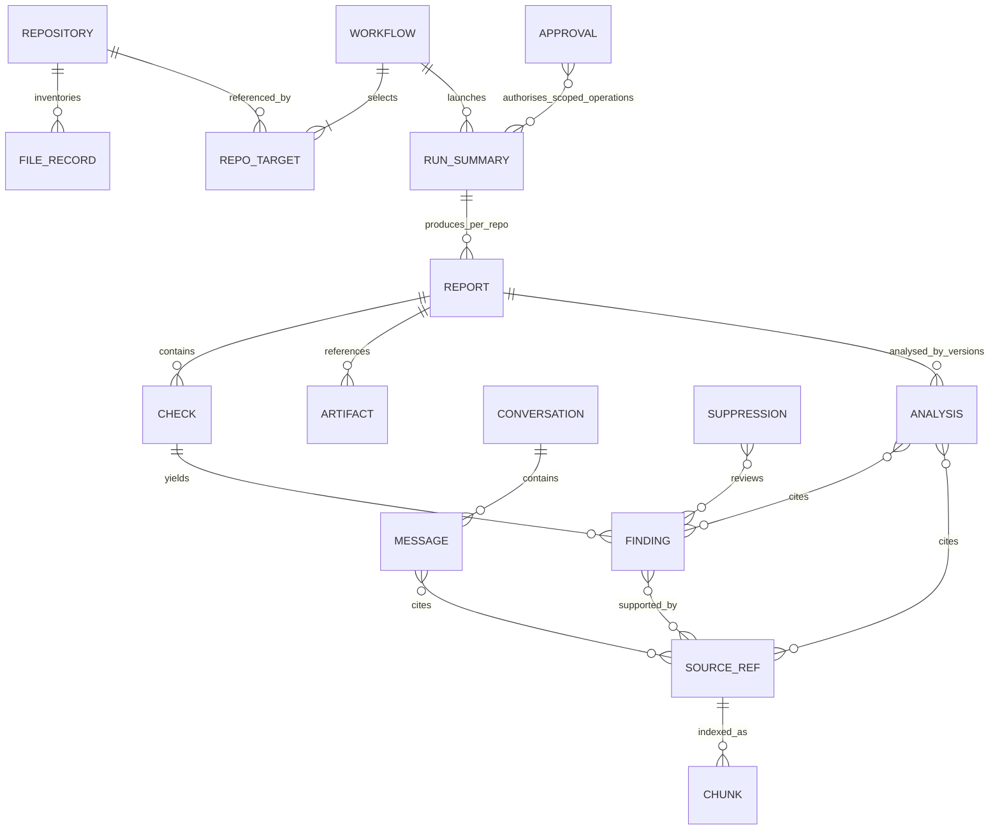

# PWT YAML Security Workbench — Database and Data Schema

Consolidated revision 0.3. Includes all decisions through 23 October 2026: OpenRouter BYOK; local JSON/Markdown/PDF; named tool and wrapper plan; one core developer plus a Figma design team; Opus-led verification, Sonnet implementation, Haiku documentation and owner-approved debug cycles. This specification is not evidence of implemented code or completed tests. Earlier v0.1/v0.2 wording is superseded by this consolidated set.

Version: 0.3.5 (amendments CA-01, CA-02, CA-03, CA-04; store contract 1.4, wrapper protocol 1.1, app contract 1.1, UI schema 1.1) | Date: 2026-10-23 | Status: Proposed implementation contract

Change record 2026-10-31 (proposed, not implemented): **CA-05 automatic LLM evidence analysis** (PRD ANL-01–ANL-12; change contract `planning/CA-05-automatic-evidence-analysis.md`). Sections marked "CA-05" describe proposed behaviour pending owner approval; current contract versions above are unchanged until CA-05 is applied.

## 1. Storage decision

The initial “database” is an application-owned JSON document store. A SQL server, SQLite file or vector database is not assumed or required. This preserves the agreed `log.json` and backup-report design. If scale later requires a transactional/indexed backend, treat that as a migration decision; keep the public report format stable.

The JSON Schema below uses Draft 2020-12, a published JSON Schema dialect. [web:132] The schema defines shape, not all runtime security/relational constraints. Code examples are illustrative proposed records, not live company repositories.

## 2. Physical file mapping

| File/directory | Root schema definition | Contents |
|---|---|---|
| `config.json` | ConfigFile | Resource limits, paths, theme, provider references, policy settings |
| `repo.json` | RepositoryFile | Registered repositories and latest discovery inventory |
| `workflows.json` | WorkflowFile | Versioned workflow definitions and selections |
| `approvals.json` | ApprovalFile | Pending decisions and constrained grants/denials |
| `log.json` | LogFile | Run summaries, sanitised events, report manifests |
| `suppressions.json` | SuppressionFile | Reserved: justified finding suppressions (RES-06 deferred; not written by the pilot) |
| `backup/<timestamp>_<repo-slug>_<run-id>.json` | ReportFile | Immutable per-repository assessment snapshot |
| Matching `.md` report | Derived text | Deterministic evidence; under CA-05 (proposed) the combined report also renders the validated analysis or an analysis-stage notice, labelled by origin |
| `analysis/<timestamp>_<repo-slug>_<run-id>_a<version>-t<attempt>.json` | AnalysisFile (proposed store 1.5, CA-05 §26; not in the 1.4 schema) | Immutable record of one attempt of one logical automatic evidence analysis |
| Matching `.pdf` report | Derived binary | Restricted local conversion; independent export result |
| `tools.json` | ToolManifestFile | Versioned adapter/tool availability, pinned contracts and licensing metadata |
| `rag/index.json` | RagIndexFile | Sanitised retrievable chunks and provenance |
| `rag/conversations.json` | ConversationFile | Sanitised chat history only when persistence is enabled |
| `checkouts/<repo-id>/` | Not a JSON store | Tool-managed Git checkout; may contain original sensitive source |
| `tmp/`, `cache/` | Adapter-owned bounded formats | Approved transient/generated inputs; retention controlled |

The app-data root is platform-resolved or explicitly configured. Store relative internal paths where possible. Never store passwords, API keys, raw detected secrets, raw authentication output, or unrestricted raw scanner output in these JSON stores. OpenRouter is the pilot runtime provider. Credentials are session-only or an opaque OS credential-store reference, never key values. No PWT runtime server/shared key is required.

Operational stores are application-writeable; source repositories are assessment-read-only except approved Git clone/update operations. This is the agreed distinction between no auto-remediation and necessary app persistence.

## 3. Logical entity relationship model



`ANALYSIS` is proposed by CA-05 (§26) and is not part of store 1.4.

Relationships are logical and frequently embedded, not SQL foreign keys. Ad-hoc runs have no workflow. Reports remain interpretable if a repository/workflow is later removed because they retain frozen plan/provenance. The schema permits historical IDs without requiring current registration to exist.

## 4. Identity and common conventions

- Primary identifiers: UUID strings. Repository names, branch names and slugs are not primary keys.
- Repository-relative paths: forward-slash storage form; runtime rejects absolute/escaping paths and translates to native paths at access time.
- Source locations: one-based lines/documents; null when unavailable. Generated location is not invented source location.
- Timestamps: UTC RFC 3339 for persisted events; schedule separately stores IANA timezone and local-time intent.
- Git OIDs: accept full 40- or 64-character lowercase hex IDs; do not assume every repo uses the same hash algorithm.
- Application content digests: SHA-256 hex. Avoid using raw secret or an unsalted secret hash as a persisted fingerprint input.
- Fingerprints: stable rule/repository/path/normalised-location or resource identity; exclude raw secret values. A secret finding can use rule + location; do not persist reversible secret snippets.
- `schema_version`: storage-contract version, independent of app/scanner versions.
- `revision`: workflow definition revision. Historical runs retain their own plan snapshot.
- `store_type`: discriminates root document shapes.

## 5. Entity dictionary

| Entity | Key | Notes |
|---|---|---|
| Repository | repo_id | Canonical remote, local checkout, default ref, latest inventory |
| FileRecord | file_id | Stable UUID for repo/path; current digest and framework are observations |
| Workflow | workflow_id + revision | Targets, checks, schedule, approval references |
| Approval | approval_id | Capability, operation fingerprint, destinations/data classes, validity |
| RunSummary | run_id | Lifecycle and immutable plan snapshot, aggregate coverage, report IDs |
| Check | check_id | Specific capability result with task/tool provenance |
| Finding | finding_id | Redacted evidence, engine, severity, source refs and review state |
| Artifact | artifact_id | Generated/external/schema/doc provenance; retained path optional |
| Report | report_id | Per-run/per-repo evidence; authoritative machine-readable payload |
| Event | event_id | Sanitised structured activity, not unrestricted free-form process output |
| Chunk | chunk_id | Redacted text plus exact provenance and optional embedding reference |
| Conversation | conversation_id | Explicit context and optional persisted sanitised messages |
| Suppression | suppression_id | Rule/fingerprint scope, rationale, actor and optional expiry |
| Analysis (proposed, CA-05) | analysis_id (logical analysis, `analysis_version` per report); record_id + attempt_seq per attempt | Logical analysis with one or more immutable attempt records: evidence snapshot digest/manifest and AI evidence coverage, provider/model, versions, provider requests, usage when reported, validation, origin-labelled cited content |

## 6. Status and counting semantics

Run execution: queued, awaiting_approval, running, cancelling, completed, partial, failed, cancelled, interrupted.

Check outcome: pending, running, passed, findings, failed, unsupported, skipped, incomplete, cancelled.

Assessment: findings, no_findings, unknown. Coverage: complete, partial, none.

Proposed by CA-05 (§26, not in store 1.4): attempt status `pending`, `awaiting_approval`, `running`, `validating` (non-terminal, log manifest only), `completed`, `blocked`, `failed`, `cancelled`, `interrupted`, `not_performed` (terminal, written as records). AI evidence coverage `complete`, `partial`, `none`. Workflow completion `in_progress`, `complete`, `incomplete` with `incomplete_stages` ⊆ {scanner, analysis, report}.

- Four separate dimensions: workflow completion (stages), scanner coverage (`Coverage`), AI evidence coverage and finding presence (`Assessment`). None implies another and none is derived from another; no combined clean/secure value exists.
- Completion describes stages, not security: `complete` can coexist with critical findings, partial scanner coverage or partial AI evidence coverage; a blocked or failed analysis makes the workflow `incomplete` while its scanner evidence stays valid.

- `completed` does not mean clean. A completed assessment may contain critical findings.
- `assessment=no_findings` only describes available evidence; the UI must qualify it if coverage is partial/none.
- `assessment=unknown` applies where there is no meaningful assessment evidence.
- A check with findings may end incomplete; retain findings but do not label its execution passed.
- File counts count unique discovered/selected file identities within the reported scope. Check counts count check records, not files or rules unless explicitly modelled as separate checks.
- Run aggregates deduplicate target/file identities across per-repo reports. A reference artifact is not an extra selected source file.
- Terminal report checks may not be left pending/running. Convert abandoned work to incomplete/cancelled with explanation during finalisation/recovery.
- Suppressed findings remain in the report and coverage history. “Resolved” is a comparison result requiring compatible completed coverage, not inferred because a check failed or a file was omitted.

## 7. Canonical JSON Schema

This single schema validates all proposed root store types via `oneOf` and `$defs`. An implementation may split it into files while preserving references and versioning. All fields are required unless explicitly optional in the schema; nullable fields represent unknown/not-applicable values. Collections may be empty unless semantic validation below prohibits it for an enabled operation.

```json
{
  "$schema": "https://json-schema.org/draft/2020-12/schema",
  "$comment": "Store contract 1.4 / wrapper protocol 1.1 = store 1.2 / protocol 1.0 plus pre-implementation amendment CA-01 (2026-10-23, identifiers retained) plus amendment CA-02 (2026-10-24, store 1.3 / protocol 1.1) plus amendment CA-03 (2026-10-26, canonical tool availability; store 1.4, protocol unchanged). See 05_Database_Data_Schema.md sections 19 and 22-24.",
  "title": "PWT Workbench Store Contract v1.4",
  "description": "Proposed shared contract; semantic and referential constraints are enforced by application code.",
  "oneOf": [
    {
      "$ref": "#/$defs/ConfigFile"
    },
    {
      "$ref": "#/$defs/RepositoryFile"
    },
    {
      "$ref": "#/$defs/WorkflowFile"
    },
    {
      "$ref": "#/$defs/ApprovalFile"
    },
    {
      "$ref": "#/$defs/LogFile"
    },
    {
      "$ref": "#/$defs/SuppressionFile"
    },
    {
      "$ref": "#/$defs/RagIndexFile"
    },
    {
      "$ref": "#/$defs/ConversationFile"
    },
    {
      "$ref": "#/$defs/ReportFile"
    },
    {
      "$ref": "#/$defs/ToolManifestFile"
    }
  ],
  "$defs": {
    "Id": {
      "type": "string",
      "format": "uuid"
    },
    "Timestamp": {
      "type": "string",
      "format": "date-time"
    },
    "Digest": {
      "type": "string",
      "pattern": "^[a-f0-9]{64}$"
    },
    "GitOid": {
      "type": "string",
      "pattern": "^(?:[a-f0-9]{40}|[a-f0-9]{64})$"
    },
    "RelativePath": {
      "type": "string",
      "minLength": 1,
      "description": "Repository-relative forward-slash path. Runtime rejects absolute, drive, dot-dot, NUL and escaping paths."
    },
    "Category": {
      "type": "string",
      "enum": [
        "syntax",
        "schema",
        "secrets",
        "misconfiguration",
        "vulnerability",
        "external_verification",
        "style",
        "workflow_validation",
        "rendering"
      ]
    },
    "Execution": {
      "type": "string",
      "enum": [
        "queued",
        "awaiting_approval",
        "running",
        "cancelling",
        "completed",
        "partial",
        "failed",
        "cancelled",
        "interrupted"
      ]
    },
    "Outcome": {
      "type": "string",
      "enum": [
        "pending",
        "running",
        "passed",
        "findings",
        "failed",
        "unsupported",
        "skipped",
        "incomplete",
        "cancelled"
      ]
    },
    "Assessment": {
      "type": "string",
      "enum": [
        "findings",
        "no_findings",
        "unknown"
      ]
    },
    "Coverage": {
      "type": "string",
      "enum": [
        "complete",
        "partial",
        "none"
      ]
    },
    "Severity": {
      "type": "string",
      "enum": [
        "critical",
        "high",
        "medium",
        "low",
        "info",
        "unknown"
      ]
    },
    "Selector": {
      "type": "object",
      "additionalProperties": false,
      "properties": {
        "mode": {
          "type": "string",
          "enum": [
            "all_yaml",
            "explicit",
            "patterns"
          ]
        },
        "paths": {
          "type": "array",
          "items": {
            "$ref": "#/$defs/RelativePath"
          }
        },
        "include_patterns": {
          "type": "array",
          "items": {
            "type": "string"
          }
        },
        "exclude_patterns": {
          "type": "array",
          "items": {
            "type": "string"
          }
        }
      },
      "required": [
        "mode",
        "paths",
        "include_patterns",
        "exclude_patterns"
      ]
    },
    "RepoTarget": {
      "type": "object",
      "additionalProperties": false,
      "properties": {
        "repo_id": {
          "$ref": "#/$defs/Id"
        },
        "ref_kind": {
          "type": "string",
          "enum": [
            "branch",
            "tag",
            "commit"
          ]
        },
        "ref_value": {
          "type": "string"
        },
        "selector": {
          "$ref": "#/$defs/Selector"
        }
      },
      "required": [
        "repo_id",
        "ref_kind",
        "ref_value",
        "selector"
      ]
    },
    "SchemaBinding": {
      "type": "object",
      "additionalProperties": false,
      "properties": {
        "path_pattern": {
          "type": "string"
        },
        "schema_resource": {
          "type": "string"
        },
        "dialect": {
          "anyOf": [
            {
              "type": "string"
            },
            {
              "type": "null"
            }
          ]
        },
        "expected_digest": {
          "anyOf": [
            {
              "$ref": "#/$defs/Digest"
            },
            {
              "type": "null"
            }
          ]
        }
      },
      "required": [
        "path_pattern",
        "schema_resource",
        "dialect",
        "expected_digest"
      ]
    },
    "RendererSetting": {
      "type": "object",
      "additionalProperties": false,
      "properties": {
        "framework": {
          "type": "string"
        },
        "renderer_id": {
          "type": "string"
        },
        "input_paths": {
          "type": "array",
          "items": {
            "$ref": "#/$defs/RelativePath"
          }
        },
        "parameters_redacted": {
          "type": "object",
          "additionalProperties": {
            "type": "string"
          }
        }
      },
      "required": [
        "framework",
        "renderer_id",
        "input_paths",
        "parameters_redacted"
      ]
    },
    "ScanSettings": {
      "type": "object",
      "additionalProperties": false,
      "properties": {
        "categories": {
          "type": "array",
          "items": {
            "$ref": "#/$defs/Category"
          }
        },
        "secret_scope": {
          "type": "string",
          "enum": [
            "checkout",
            "history"
          ]
        },
        "template_mode": {
          "type": "string",
          "enum": [
            "source",
            "rendered",
            "both"
          ]
        },
        "schema_mode": {
          "type": "string",
          "enum": [
            "automatic",
            "user_supplied",
            "both"
          ]
        },
        "schema_bindings": {
          "type": "array",
          "items": {
            "$ref": "#/$defs/SchemaBinding"
          }
        },
        "renderers": {
          "type": "array",
          "items": {
            "$ref": "#/$defs/RendererSetting"
          }
        },
        "allow_reference_context": {
          "type": "boolean"
        },
        "adapter_ids": {
          "type": "array",
          "items": {
            "type": "string"
          }
        }
      },
      "required": [
        "categories",
        "secret_scope",
        "template_mode",
        "schema_mode",
        "schema_bindings",
        "renderers",
        "allow_reference_context",
        "adapter_ids"
      ]
    },
    "FileRecord": {
      "type": "object",
      "additionalProperties": false,
      "properties": {
        "file_id": {
          "$ref": "#/$defs/Id"
        },
        "path": {
          "$ref": "#/$defs/RelativePath"
        },
        "byte_size": {
          "type": "integer",
          "minimum": 0
        },
        "content_digest": {
          "anyOf": [
            {
              "$ref": "#/$defs/Digest"
            },
            {
              "type": "null"
            }
          ]
        },
        "commit_oid": {
          "$ref": "#/$defs/GitOid"
        },
        "detected_framework": {
          "anyOf": [
            {
              "type": "string"
            },
            {
              "type": "null"
            }
          ]
        },
        "discovery_state": {
          "type": "string",
          "enum": [
            "eligible",
            "excluded",
            "unreadable"
          ]
        },
        "reason": {
          "anyOf": [
            {
              "type": "string"
            },
            {
              "type": "null"
            }
          ]
        }
      },
      "required": [
        "file_id",
        "path",
        "byte_size",
        "content_digest",
        "commit_oid",
        "detected_framework",
        "discovery_state",
        "reason"
      ]
    },
    "Repository": {
      "type": "object",
      "additionalProperties": false,
      "properties": {
        "repo_id": {
          "$ref": "#/$defs/Id"
        },
        "display_name": {
          "type": "string"
        },
        "slug": {
          "type": "string"
        },
        "remote_url": {
          "type": "string"
        },
        "canonical_remote": {
          "type": "string"
        },
        "local_path": {
          "type": "string"
        },
        "default_ref_kind": {
          "type": "string",
          "enum": [
            "branch",
            "tag",
            "commit"
          ]
        },
        "default_ref_value": {
          "type": "string"
        },
        "registered_at": {
          "$ref": "#/$defs/Timestamp"
        },
        "last_update_at": {
          "anyOf": [
            {
              "$ref": "#/$defs/Timestamp"
            },
            {
              "type": "null"
            }
          ]
        },
        "last_commit_oid": {
          "anyOf": [
            {
              "$ref": "#/$defs/GitOid"
            },
            {
              "type": "null"
            }
          ]
        },
        "checkout_state": {
          "type": "string",
          "enum": [
            "not_cloned",
            "ready",
            "dirty",
            "updating",
            "error"
          ]
        },
        "last_error_redacted": {
          "anyOf": [
            {
              "type": "string"
            },
            {
              "type": "null"
            }
          ]
        },
        "inventory_revision": {
          "type": "integer",
          "minimum": 0
        },
        "inventory_at": {
          "anyOf": [
            {
              "$ref": "#/$defs/Timestamp"
            },
            {
              "type": "null"
            }
          ]
        },
        "files": {
          "type": "array",
          "items": {
            "$ref": "#/$defs/FileRecord"
          }
        }
      },
      "required": [
        "repo_id",
        "display_name",
        "slug",
        "remote_url",
        "canonical_remote",
        "local_path",
        "default_ref_kind",
        "default_ref_value",
        "registered_at",
        "last_update_at",
        "last_commit_oid",
        "checkout_state",
        "last_error_redacted",
        "inventory_revision",
        "inventory_at",
        "files"
      ]
    },
    "Schedule": {
      "type": "object",
      "additionalProperties": false,
      "properties": {
        "kind": {
          "type": "string",
          "enum": [
            "manual",
            "interval",
            "daily"
          ]
        },
        "interval_seconds": {
          "anyOf": [
            {
              "type": "integer",
              "minimum": 1
            },
            {
              "type": "null"
            }
          ]
        },
        "daily_local_time": {
          "anyOf": [
            {
              "type": "string"
            },
            {
              "type": "null"
            }
          ]
        },
        "timezone": {
          "type": "string"
        },
        "next_due_at": {
          "anyOf": [
            {
              "$ref": "#/$defs/Timestamp"
            },
            {
              "type": "null"
            }
          ]
        },
        "overlap_policy": {
          "type": "string",
          "enum": [
            "skip_if_running"
          ]
        },
        "missed_policy": {
          "type": "string",
          "enum": [
            "record_no_replay"
          ]
        }
      },
      "required": [
        "kind",
        "interval_seconds",
        "daily_local_time",
        "timezone",
        "next_due_at",
        "overlap_policy",
        "missed_policy"
      ]
    },
    "Workflow": {
      "type": "object",
      "additionalProperties": false,
      "properties": {
        "workflow_id": {
          "$ref": "#/$defs/Id"
        },
        "revision": {
          "type": "integer",
          "minimum": 1
        },
        "name": {
          "type": "string"
        },
        "description": {
          "type": "string"
        },
        "enabled": {
          "type": "boolean"
        },
        "created_at": {
          "$ref": "#/$defs/Timestamp"
        },
        "updated_at": {
          "$ref": "#/$defs/Timestamp"
        },
        "targets": {
          "type": "array",
          "items": {
            "$ref": "#/$defs/RepoTarget"
          }
        },
        "scan_settings": {
          "$ref": "#/$defs/ScanSettings"
        },
        "schedule": {
          "$ref": "#/$defs/Schedule"
        },
        "approval_ids": {
          "type": "array",
          "items": {
            "$ref": "#/$defs/Id"
          }
        },
        "output_formats": {
          "type": "array",
          "items": {
            "type": "string",
            "enum": [
              "json",
              "md",
              "pdf"
            ]
          },
          "uniqueItems": true,
          "minItems": 1
        }
      },
      "required": [
        "workflow_id",
        "revision",
        "name",
        "description",
        "enabled",
        "created_at",
        "updated_at",
        "targets",
        "scan_settings",
        "schedule",
        "approval_ids",
        "output_formats"
      ]
    },
    "Capability": {
      "type": "string",
      "enum": [
        "git_acquire",
        "git_update",
        "external_reference",
        "schema_fetch",
        "vulnerability_lookup",
        "documentation_fetch",
        "model_transmission",
        "embedding_transmission",
        "local_render",
        "non_mutating_verification",
        "app_storage"
      ]
    },
    "Approval": {
      "type": "object",
      "additionalProperties": false,
      "properties": {
        "approval_id": {
          "$ref": "#/$defs/Id"
        },
        "status": {
          "type": "string",
          "enum": [
            "pending",
            "approved",
            "denied",
            "cancelled",
            "revoked",
            "expired"
          ]
        },
        "capability": {
          "$ref": "#/$defs/Capability"
        },
        "workflow_id": {
          "anyOf": [
            {
              "$ref": "#/$defs/Id"
            },
            {
              "type": "null"
            }
          ]
        },
        "workflow_revision": {
          "anyOf": [
            {
              "type": "integer",
              "minimum": 1
            },
            {
              "type": "null"
            }
          ]
        },
        "run_id": {
          "anyOf": [
            {
              "$ref": "#/$defs/Id"
            },
            {
              "type": "null"
            }
          ]
        },
        "repo_ids": {
          "type": "array",
          "items": {
            "$ref": "#/$defs/Id"
          }
        },
        "purpose": {
          "type": "string"
        },
        "operation_fingerprint": {
          "$ref": "#/$defs/Digest"
        },
        "destinations": {
          "type": "array",
          "items": {
            "type": "string"
          }
        },
        "resource_constraints": {
          "type": "array",
          "items": {
            "type": "string"
          }
        },
        "data_categories": {
          "type": "array",
          "items": {
            "type": "string",
            "enum": [
              "repository_metadata",
              "redacted_source",
              "redacted_findings",
              "schema_documents",
              "public_artifact_identifiers",
              "redacted_chat_context",
              "app_metadata"
            ]
          }
        },
        "lifetime": {
          "type": "string",
          "enum": [
            "once",
            "run",
            "workflow_revision"
          ]
        },
        "requested_at": {
          "$ref": "#/$defs/Timestamp"
        },
        "decided_at": {
          "anyOf": [
            {
              "$ref": "#/$defs/Timestamp"
            },
            {
              "type": "null"
            }
          ]
        },
        "expires_at": {
          "anyOf": [
            {
              "$ref": "#/$defs/Timestamp"
            },
            {
              "type": "null"
            }
          ]
        },
        "actor": {
          "type": "string"
        },
        "consumed": {
          "type": "boolean"
        },
        "inference_scope": {
          "anyOf": [
            {
              "$ref": "#/$defs/InferenceScope"
            },
            {
              "type": "null"
            }
          ]
        }
      },
      "required": [
        "approval_id",
        "status",
        "capability",
        "workflow_id",
        "workflow_revision",
        "run_id",
        "repo_ids",
        "purpose",
        "operation_fingerprint",
        "destinations",
        "resource_constraints",
        "data_categories",
        "lifetime",
        "requested_at",
        "decided_at",
        "expires_at",
        "actor",
        "consumed",
        "inference_scope"
      ]
    },
    "SourceRef": {
      "type": "object",
      "additionalProperties": false,
      "properties": {
        "source_id": {
          "$ref": "#/$defs/Id"
        },
        "kind": {
          "type": "string",
          "enum": [
            "repository_file",
            "rendered_artifact",
            "scan_report",
            "activity_log",
            "workflow",
            "rule_document",
            "schema_document",
            "external_reference"
          ]
        },
        "repo_id": {
          "anyOf": [
            {
              "$ref": "#/$defs/Id"
            },
            {
              "type": "null"
            }
          ]
        },
        "commit_oid": {
          "anyOf": [
            {
              "$ref": "#/$defs/GitOid"
            },
            {
              "type": "null"
            }
          ]
        },
        "run_id": {
          "anyOf": [
            {
              "$ref": "#/$defs/Id"
            },
            {
              "type": "null"
            }
          ]
        },
        "file_path": {
          "anyOf": [
            {
              "$ref": "#/$defs/RelativePath"
            },
            {
              "type": "null"
            }
          ]
        },
        "artifact_id": {
          "anyOf": [
            {
              "$ref": "#/$defs/Id"
            },
            {
              "type": "null"
            }
          ]
        },
        "document_index": {
          "anyOf": [
            {
              "type": "integer",
              "minimum": 1
            },
            {
              "type": "null"
            }
          ]
        },
        "line_start": {
          "anyOf": [
            {
              "type": "integer",
              "minimum": 1
            },
            {
              "type": "null"
            }
          ]
        },
        "line_end": {
          "anyOf": [
            {
              "type": "integer",
              "minimum": 1
            },
            {
              "type": "null"
            }
          ]
        },
        "resource_identifier": {
          "anyOf": [
            {
              "type": "string"
            },
            {
              "type": "null"
            }
          ]
        },
        "content_digest": {
          "anyOf": [
            {
              "$ref": "#/$defs/Digest"
            },
            {
              "type": "null"
            }
          ]
        },
        "retrieved_at": {
          "$ref": "#/$defs/Timestamp"
        },
        "approval_id": {
          "anyOf": [
            {
              "$ref": "#/$defs/Id"
            },
            {
              "type": "null"
            }
          ]
        },
        "redaction_version": {
          "type": "string"
        },
        "stale": {
          "type": "boolean"
        }
      },
      "required": [
        "source_id",
        "kind",
        "repo_id",
        "commit_oid",
        "run_id",
        "file_path",
        "artifact_id",
        "document_index",
        "line_start",
        "line_end",
        "resource_identifier",
        "content_digest",
        "retrieved_at",
        "approval_id",
        "redaction_version",
        "stale"
      ]
    },
    "Engine": {
      "type": "object",
      "additionalProperties": false,
      "properties": {
        "adapter_id": {
          "type": "string"
        },
        "adapter_version": {
          "type": "string"
        },
        "tool_name": {
          "type": "string"
        },
        "tool_version": {
          "type": "string"
        },
        "ruleset_version": {
          "anyOf": [
            {
              "type": "string"
            },
            {
              "type": "null"
            }
          ]
        },
        "data_updated_at": {
          "anyOf": [
            {
              "$ref": "#/$defs/Timestamp"
            },
            {
              "type": "null"
            }
          ]
        }
      },
      "required": [
        "adapter_id",
        "adapter_version",
        "tool_name",
        "tool_version",
        "ruleset_version",
        "data_updated_at"
      ]
    },
    "Check": {
      "type": "object",
      "additionalProperties": false,
      "properties": {
        "check_id": {
          "$ref": "#/$defs/Id"
        },
        "task_id": {
          "$ref": "#/$defs/Id"
        },
        "file_id": {
          "anyOf": [
            {
              "$ref": "#/$defs/Id"
            },
            {
              "type": "null"
            }
          ]
        },
        "category": {
          "$ref": "#/$defs/Category"
        },
        "framework": {
          "anyOf": [
            {
              "type": "string"
            },
            {
              "type": "null"
            }
          ]
        },
        "engine": {
          "$ref": "#/$defs/Engine"
        },
        "outcome": {
          "$ref": "#/$defs/Outcome"
        },
        "reason_redacted": {
          "anyOf": [
            {
              "type": "string"
            },
            {
              "type": "null"
            }
          ]
        },
        "started_at": {
          "anyOf": [
            {
              "$ref": "#/$defs/Timestamp"
            },
            {
              "type": "null"
            }
          ]
        },
        "finished_at": {
          "anyOf": [
            {
              "$ref": "#/$defs/Timestamp"
            },
            {
              "type": "null"
            }
          ]
        },
        "finding_ids": {
          "type": "array",
          "items": {
            "$ref": "#/$defs/Id"
          }
        },
        "source_refs": {
          "type": "array",
          "items": {
            "$ref": "#/$defs/SourceRef"
          }
        },
        "adapter_id": {
          "type": "string"
        },
        "config_digest": {
          "anyOf": [
            {
              "$ref": "#/$defs/Digest"
            },
            {
              "type": "null"
            }
          ]
        },
        "manifest_digest": {
          "anyOf": [
            {
              "$ref": "#/$defs/Digest"
            },
            {
              "type": "null"
            }
          ]
        },
        "exit_code": {
          "anyOf": [
            {
              "type": "integer"
            },
            {
              "type": "null"
            }
          ]
        },
        "term_signal": {
          "anyOf": [
            {
              "type": "integer",
              "minimum": 1
            },
            {
              "type": "null"
            }
          ]
        },
        "native_status": {
          "type": "string",
          "enum": [
            "not_started",
            "exited",
            "timed_out",
            "cancelled",
            "launch_failed",
            "output_limit_exceeded"
          ]
        },
        "approval_ids": {
          "type": "array",
          "items": {
            "$ref": "#/$defs/Id"
          }
        }
      },
      "required": [
        "check_id",
        "task_id",
        "file_id",
        "category",
        "framework",
        "engine",
        "outcome",
        "reason_redacted",
        "started_at",
        "finished_at",
        "finding_ids",
        "source_refs",
        "adapter_id",
        "config_digest",
        "manifest_digest",
        "exit_code",
        "term_signal",
        "native_status",
        "approval_ids"
      ]
    },
    "Finding": {
      "type": "object",
      "additionalProperties": false,
      "properties": {
        "finding_id": {
          "$ref": "#/$defs/Id"
        },
        "fingerprint": {
          "$ref": "#/$defs/Digest"
        },
        "check_id": {
          "$ref": "#/$defs/Id"
        },
        "task_id": {
          "$ref": "#/$defs/Id"
        },
        "repo_id": {
          "$ref": "#/$defs/Id"
        },
        "run_id": {
          "$ref": "#/$defs/Id"
        },
        "commit_oid": {
          "$ref": "#/$defs/GitOid"
        },
        "category": {
          "$ref": "#/$defs/Category"
        },
        "severity": {
          "$ref": "#/$defs/Severity"
        },
        "confidence": {
          "type": "string",
          "enum": [
            "high",
            "medium",
            "low",
            "unknown"
          ]
        },
        "rule_id": {
          "type": "string"
        },
        "title": {
          "type": "string"
        },
        "description_redacted": {
          "type": "string"
        },
        "evidence_redacted": {
          "type": "string"
        },
        "remediation_redacted": {
          "type": "string"
        },
        "engine": {
          "$ref": "#/$defs/Engine"
        },
        "sources": {
          "type": "array",
          "items": {
            "$ref": "#/$defs/SourceRef"
          }
        },
        "review_status": {
          "type": "string",
          "enum": [
            "new",
            "existing",
            "suppressed"
          ]
        },
        "suppression_id": {
          "anyOf": [
            {
              "$ref": "#/$defs/Id"
            },
            {
              "type": "null"
            }
          ]
        },
        "observed_at": {
          "$ref": "#/$defs/Timestamp"
        }
      },
      "required": [
        "finding_id",
        "fingerprint",
        "check_id",
        "task_id",
        "repo_id",
        "run_id",
        "commit_oid",
        "category",
        "severity",
        "confidence",
        "rule_id",
        "title",
        "description_redacted",
        "evidence_redacted",
        "remediation_redacted",
        "engine",
        "sources",
        "review_status",
        "suppression_id",
        "observed_at"
      ]
    },
    "Artifact": {
      "type": "object",
      "additionalProperties": false,
      "properties": {
        "artifact_id": {
          "$ref": "#/$defs/Id"
        },
        "kind": {
          "type": "string",
          "enum": [
            "rendered",
            "external",
            "schema",
            "rule_document"
          ]
        },
        "display_name": {
          "type": "string"
        },
        "content_digest": {
          "$ref": "#/$defs/Digest"
        },
        "retained_path": {
          "anyOf": [
            {
              "type": "string"
            },
            {
              "type": "null"
            }
          ]
        },
        "source_refs": {
          "type": "array",
          "items": {
            "$ref": "#/$defs/SourceRef"
          }
        },
        "approval_id": {
          "anyOf": [
            {
              "$ref": "#/$defs/Id"
            },
            {
              "type": "null"
            }
          ]
        },
        "contains_only_redacted_retained_content": {
          "type": "boolean"
        }
      },
      "required": [
        "artifact_id",
        "kind",
        "display_name",
        "content_digest",
        "retained_path",
        "source_refs",
        "approval_id",
        "contains_only_redacted_retained_content"
      ]
    },
    "CoverageSummary": {
      "type": "object",
      "additionalProperties": false,
      "properties": {
        "discovered_files": {
          "type": "integer",
          "minimum": 0
        },
        "selected_files": {
          "type": "integer",
          "minimum": 0
        },
        "assessed_files": {
          "type": "integer",
          "minimum": 0
        },
        "excluded_files": {
          "type": "integer",
          "minimum": 0
        },
        "missing_files": {
          "type": "integer",
          "minimum": 0
        },
        "checks_passed": {
          "type": "integer",
          "minimum": 0
        },
        "checks_with_findings": {
          "type": "integer",
          "minimum": 0
        },
        "checks_failed": {
          "type": "integer",
          "minimum": 0
        },
        "checks_unsupported": {
          "type": "integer",
          "minimum": 0
        },
        "checks_skipped": {
          "type": "integer",
          "minimum": 0
        },
        "checks_incomplete": {
          "type": "integer",
          "minimum": 0
        },
        "checks_cancelled": {
          "type": "integer",
          "minimum": 0
        },
        "coverage": {
          "$ref": "#/$defs/Coverage"
        },
        "assessment": {
          "$ref": "#/$defs/Assessment"
        }
      },
      "required": [
        "discovered_files",
        "selected_files",
        "assessed_files",
        "excluded_files",
        "missing_files",
        "checks_passed",
        "checks_with_findings",
        "checks_failed",
        "checks_unsupported",
        "checks_skipped",
        "checks_incomplete",
        "checks_cancelled",
        "coverage",
        "assessment"
      ]
    },
    "PlanSnapshot": {
      "type": "object",
      "additionalProperties": false,
      "properties": {
        "workflow_id": {
          "anyOf": [
            {
              "$ref": "#/$defs/Id"
            },
            {
              "type": "null"
            }
          ]
        },
        "workflow_revision": {
          "anyOf": [
            {
              "type": "integer",
              "minimum": 1
            },
            {
              "type": "null"
            }
          ]
        },
        "targets": {
          "type": "array",
          "items": {
            "$ref": "#/$defs/RepoTarget"
          }
        },
        "scan_settings": {
          "$ref": "#/$defs/ScanSettings"
        },
        "approval_ids": {
          "type": "array",
          "items": {
            "$ref": "#/$defs/Id"
          }
        },
        "created_at": {
          "$ref": "#/$defs/Timestamp"
        },
        "plan_digest": {
          "$ref": "#/$defs/Digest"
        },
        "target_snapshots": {
          "type": "array",
          "items": {
            "$ref": "#/$defs/TargetSnapshot"
          }
        },
        "engine_snapshots": {
          "type": "array",
          "items": {
            "$ref": "#/$defs/EngineSnapshot"
          }
        }
      },
      "required": [
        "workflow_id",
        "workflow_revision",
        "targets",
        "scan_settings",
        "approval_ids",
        "created_at",
        "plan_digest",
        "target_snapshots",
        "engine_snapshots"
      ]
    },
    "RunSummary": {
      "type": "object",
      "additionalProperties": false,
      "properties": {
        "run_id": {
          "$ref": "#/$defs/Id"
        },
        "trigger": {
          "type": "string",
          "enum": [
            "manual",
            "interval",
            "daily"
          ]
        },
        "execution": {
          "$ref": "#/$defs/Execution"
        },
        "created_at": {
          "$ref": "#/$defs/Timestamp"
        },
        "started_at": {
          "anyOf": [
            {
              "$ref": "#/$defs/Timestamp"
            },
            {
              "type": "null"
            }
          ]
        },
        "finished_at": {
          "anyOf": [
            {
              "$ref": "#/$defs/Timestamp"
            },
            {
              "type": "null"
            }
          ]
        },
        "plan": {
          "$ref": "#/$defs/PlanSnapshot"
        },
        "coverage": {
          "$ref": "#/$defs/CoverageSummary"
        },
        "report_ids": {
          "type": "array",
          "items": {
            "$ref": "#/$defs/Id"
          }
        },
        "last_checkpoint_at": {
          "anyOf": [
            {
              "$ref": "#/$defs/Timestamp"
            },
            {
              "type": "null"
            }
          ]
        }
      },
      "required": [
        "run_id",
        "trigger",
        "execution",
        "created_at",
        "started_at",
        "finished_at",
        "plan",
        "coverage",
        "report_ids",
        "last_checkpoint_at"
      ]
    },
    "Event": {
      "type": "object",
      "additionalProperties": false,
      "properties": {
        "event_id": {
          "$ref": "#/$defs/Id"
        },
        "at": {
          "$ref": "#/$defs/Timestamp"
        },
        "level": {
          "type": "string",
          "enum": [
            "debug",
            "info",
            "warning",
            "error"
          ]
        },
        "event_type": {
          "type": "string"
        },
        "run_id": {
          "anyOf": [
            {
              "$ref": "#/$defs/Id"
            },
            {
              "type": "null"
            }
          ]
        },
        "repo_id": {
          "anyOf": [
            {
              "$ref": "#/$defs/Id"
            },
            {
              "type": "null"
            }
          ]
        },
        "workflow_id": {
          "anyOf": [
            {
              "$ref": "#/$defs/Id"
            },
            {
              "type": "null"
            }
          ]
        },
        "task_id": {
          "anyOf": [
            {
              "$ref": "#/$defs/Id"
            },
            {
              "type": "null"
            }
          ]
        },
        "approval_id": {
          "anyOf": [
            {
              "$ref": "#/$defs/Id"
            },
            {
              "type": "null"
            }
          ]
        },
        "message_redacted": {
          "type": "string"
        },
        "code": {
          "anyOf": [
            {
              "type": "string"
            },
            {
              "type": "null"
            }
          ]
        }
      },
      "required": [
        "event_id",
        "at",
        "level",
        "event_type",
        "run_id",
        "repo_id",
        "workflow_id",
        "task_id",
        "approval_id",
        "message_redacted",
        "code"
      ]
    },
    "ReportManifest": {
      "type": "object",
      "additionalProperties": false,
      "properties": {
        "report_id": {
          "$ref": "#/$defs/Id"
        },
        "run_id": {
          "$ref": "#/$defs/Id"
        },
        "repo_id": {
          "$ref": "#/$defs/Id"
        },
        "json_path": {
          "type": "string"
        },
        "md_path": {
          "type": "string"
        },
        "json_written": {
          "type": "boolean"
        },
        "md_written": {
          "type": "boolean"
        },
        "json_digest": {
          "anyOf": [
            {
              "$ref": "#/$defs/Digest"
            },
            {
              "type": "null"
            }
          ]
        },
        "generated_at": {
          "$ref": "#/$defs/Timestamp"
        },
        "pdf_path": {
          "anyOf": [
            {
              "type": "string"
            },
            {
              "type": "null"
            }
          ]
        },
        "pdf_written": {
          "type": "boolean"
        },
        "pdf_digest": {
          "anyOf": [
            {
              "$ref": "#/$defs/Digest"
            },
            {
              "type": "null"
            }
          ]
        },
        "pdf_error_redacted": {
          "anyOf": [
            {
              "type": "string"
            },
            {
              "type": "null"
            }
          ]
        },
        "pdf_renderer_version": {
          "anyOf": [
            {
              "type": "string"
            },
            {
              "type": "null"
            }
          ]
        }
      },
      "required": [
        "report_id",
        "run_id",
        "repo_id",
        "json_path",
        "md_path",
        "json_written",
        "md_written",
        "json_digest",
        "generated_at",
        "pdf_path",
        "pdf_written",
        "pdf_digest",
        "pdf_error_redacted",
        "pdf_renderer_version"
      ]
    },
    "Suppression": {
      "type": "object",
      "additionalProperties": false,
      "properties": {
        "suppression_id": {
          "$ref": "#/$defs/Id"
        },
        "repo_id": {
          "$ref": "#/$defs/Id"
        },
        "finding_fingerprint": {
          "$ref": "#/$defs/Digest"
        },
        "rule_id": {
          "type": "string"
        },
        "reason": {
          "type": "string"
        },
        "created_at": {
          "$ref": "#/$defs/Timestamp"
        },
        "expires_at": {
          "anyOf": [
            {
              "$ref": "#/$defs/Timestamp"
            },
            {
              "type": "null"
            }
          ]
        },
        "actor": {
          "type": "string"
        },
        "enabled": {
          "type": "boolean"
        }
      },
      "required": [
        "suppression_id",
        "repo_id",
        "finding_fingerprint",
        "rule_id",
        "reason",
        "created_at",
        "expires_at",
        "actor",
        "enabled"
      ]
    },
    "Chunk": {
      "type": "object",
      "additionalProperties": false,
      "properties": {
        "chunk_id": {
          "$ref": "#/$defs/Id"
        },
        "source": {
          "$ref": "#/$defs/SourceRef"
        },
        "text_redacted": {
          "type": "string"
        },
        "content_digest": {
          "$ref": "#/$defs/Digest"
        },
        "redaction_version": {
          "type": "string"
        },
        "embedding_key": {
          "anyOf": [
            {
              "type": "string"
            },
            {
              "type": "null"
            }
          ]
        },
        "indexed_at": {
          "$ref": "#/$defs/Timestamp"
        }
      },
      "required": [
        "chunk_id",
        "source",
        "text_redacted",
        "content_digest",
        "redaction_version",
        "embedding_key",
        "indexed_at"
      ]
    },
    "ChatContext": {
      "type": "object",
      "additionalProperties": false,
      "properties": {
        "repo_ids": {
          "type": "array",
          "items": {
            "$ref": "#/$defs/Id"
          }
        },
        "run_ids": {
          "type": "array",
          "items": {
            "$ref": "#/$defs/Id"
          }
        },
        "finding_ids": {
          "type": "array",
          "items": {
            "$ref": "#/$defs/Id"
          }
        },
        "file_ids": {
          "type": "array",
          "items": {
            "$ref": "#/$defs/Id"
          }
        },
        "include_history": {
          "type": "boolean"
        }
      },
      "required": [
        "repo_ids",
        "run_ids",
        "finding_ids",
        "file_ids",
        "include_history"
      ]
    },
    "Message": {
      "type": "object",
      "additionalProperties": false,
      "properties": {
        "message_id": {
          "$ref": "#/$defs/Id"
        },
        "role": {
          "type": "string",
          "enum": [
            "user",
            "assistant",
            "system_notice"
          ]
        },
        "text_redacted": {
          "type": "string"
        },
        "source_refs": {
          "type": "array",
          "items": {
            "$ref": "#/$defs/SourceRef"
          }
        },
        "provider_id": {
          "anyOf": [
            {
              "type": "string"
            },
            {
              "type": "null"
            }
          ]
        },
        "model_id": {
          "anyOf": [
            {
              "type": "string"
            },
            {
              "type": "null"
            }
          ]
        },
        "approval_ids": {
          "type": "array",
          "items": {
            "$ref": "#/$defs/Id"
          }
        },
        "created_at": {
          "$ref": "#/$defs/Timestamp"
        },
        "status": {
          "type": "string",
          "enum": [
            "complete",
            "cancelled",
            "failed"
          ]
        },
        "tokens_in": {
          "anyOf": [
            {
              "type": "integer",
              "minimum": 0
            },
            {
              "type": "null"
            }
          ]
        },
        "tokens_out": {
          "anyOf": [
            {
              "type": "integer",
              "minimum": 0
            },
            {
              "type": "null"
            }
          ]
        }
      },
      "required": [
        "message_id",
        "role",
        "text_redacted",
        "source_refs",
        "provider_id",
        "model_id",
        "approval_ids",
        "created_at",
        "status",
        "tokens_in",
        "tokens_out"
      ]
    },
    "Conversation": {
      "type": "object",
      "additionalProperties": false,
      "properties": {
        "conversation_id": {
          "$ref": "#/$defs/Id"
        },
        "title": {
          "type": "string"
        },
        "context": {
          "$ref": "#/$defs/ChatContext"
        },
        "created_at": {
          "$ref": "#/$defs/Timestamp"
        },
        "updated_at": {
          "$ref": "#/$defs/Timestamp"
        },
        "messages": {
          "type": "array",
          "items": {
            "$ref": "#/$defs/Message"
          }
        }
      },
      "required": [
        "conversation_id",
        "title",
        "context",
        "created_at",
        "updated_at",
        "messages"
      ]
    },
    "Provider": {
      "type": "object",
      "additionalProperties": false,
      "properties": {
        "provider_id": {
          "const": "openrouter"
        },
        "kind": {
          "const": "api"
        },
        "endpoint": {
          "const": "https://openrouter.ai/api/v1"
        },
        "model_id": {
          "type": "string",
          "minLength": 1
        },
        "credential_mode": {
          "type": "string",
          "enum": [
            "session_only",
            "os_credential_store"
          ]
        },
        "credential_reference": {
          "anyOf": [
            {
              "type": "string"
            },
            {
              "type": "null"
            }
          ]
        },
        "routing_policy": {
          "$ref": "#/$defs/ProviderPolicy"
        }
      },
      "required": [
        "provider_id",
        "kind",
        "endpoint",
        "model_id",
        "credential_mode",
        "credential_reference",
        "routing_policy"
      ]
    },
    "Config": {
      "type": "object",
      "additionalProperties": false,
      "properties": {
        "app_data_root": {
          "type": "string"
        },
        "backup_directory": {
          "type": "string"
        },
        "active_theme": {
          "type": "string"
        },
        "max_active_repositories": {
          "type": "integer",
          "minimum": 1
        },
        "max_scanner_processes": {
          "type": "integer",
          "minimum": 1
        },
        "history_retention_days": {
          "anyOf": [
            {
              "type": "integer",
              "minimum": 1
            },
            {
              "type": "null"
            }
          ]
        },
        "chat_persistence_enabled": {
          "type": "boolean"
        },
        "provider": {
          "anyOf": [
            {
              "$ref": "#/$defs/Provider"
            },
            {
              "type": "null"
            }
          ]
        },
        "telemetry_enabled": {
          "const": false
        },
        "redaction_version": {
          "type": "string"
        }
      },
      "required": [
        "app_data_root",
        "backup_directory",
        "active_theme",
        "max_active_repositories",
        "max_scanner_processes",
        "history_retention_days",
        "chat_persistence_enabled",
        "provider",
        "telemetry_enabled",
        "redaction_version"
      ]
    },
    "ConfigFile": {
      "type": "object",
      "additionalProperties": false,
      "properties": {
        "schema_version": {
          "const": "1.4"
        },
        "store_type": {
          "const": "config"
        },
        "updated_at": {
          "$ref": "#/$defs/Timestamp"
        },
        "config": {
          "$ref": "#/$defs/Config"
        }
      },
      "required": [
        "schema_version",
        "store_type",
        "updated_at",
        "config"
      ]
    },
    "RepositoryFile": {
      "type": "object",
      "additionalProperties": false,
      "properties": {
        "schema_version": {
          "const": "1.4"
        },
        "store_type": {
          "const": "repositories"
        },
        "updated_at": {
          "$ref": "#/$defs/Timestamp"
        },
        "repositories": {
          "type": "array",
          "items": {
            "$ref": "#/$defs/Repository"
          }
        }
      },
      "required": [
        "schema_version",
        "store_type",
        "updated_at",
        "repositories"
      ]
    },
    "WorkflowFile": {
      "type": "object",
      "additionalProperties": false,
      "properties": {
        "schema_version": {
          "const": "1.4"
        },
        "store_type": {
          "const": "workflows"
        },
        "updated_at": {
          "$ref": "#/$defs/Timestamp"
        },
        "workflows": {
          "type": "array",
          "items": {
            "$ref": "#/$defs/Workflow"
          }
        }
      },
      "required": [
        "schema_version",
        "store_type",
        "updated_at",
        "workflows"
      ]
    },
    "ApprovalFile": {
      "type": "object",
      "additionalProperties": false,
      "properties": {
        "schema_version": {
          "const": "1.4"
        },
        "store_type": {
          "const": "approvals"
        },
        "updated_at": {
          "$ref": "#/$defs/Timestamp"
        },
        "approvals": {
          "type": "array",
          "items": {
            "$ref": "#/$defs/Approval"
          }
        }
      },
      "required": [
        "schema_version",
        "store_type",
        "updated_at",
        "approvals"
      ]
    },
    "LogFile": {
      "type": "object",
      "additionalProperties": false,
      "properties": {
        "schema_version": {
          "const": "1.4"
        },
        "store_type": {
          "const": "log"
        },
        "updated_at": {
          "$ref": "#/$defs/Timestamp"
        },
        "runs": {
          "type": "array",
          "items": {
            "$ref": "#/$defs/RunSummary"
          }
        },
        "events": {
          "type": "array",
          "items": {
            "$ref": "#/$defs/Event"
          }
        },
        "reports": {
          "type": "array",
          "items": {
            "$ref": "#/$defs/ReportManifest"
          }
        }
      },
      "required": [
        "schema_version",
        "store_type",
        "updated_at",
        "runs",
        "events",
        "reports"
      ]
    },
    "SuppressionFile": {
      "type": "object",
      "additionalProperties": false,
      "properties": {
        "schema_version": {
          "const": "1.4"
        },
        "store_type": {
          "const": "suppressions"
        },
        "updated_at": {
          "$ref": "#/$defs/Timestamp"
        },
        "suppressions": {
          "type": "array",
          "items": {
            "$ref": "#/$defs/Suppression"
          }
        }
      },
      "required": [
        "schema_version",
        "store_type",
        "updated_at",
        "suppressions"
      ]
    },
    "RagIndexFile": {
      "type": "object",
      "additionalProperties": false,
      "properties": {
        "schema_version": {
          "const": "1.4"
        },
        "store_type": {
          "const": "rag_index"
        },
        "updated_at": {
          "$ref": "#/$defs/Timestamp"
        },
        "chunks": {
          "type": "array",
          "items": {
            "$ref": "#/$defs/Chunk"
          }
        }
      },
      "required": [
        "schema_version",
        "store_type",
        "updated_at",
        "chunks"
      ]
    },
    "ConversationFile": {
      "type": "object",
      "additionalProperties": false,
      "properties": {
        "schema_version": {
          "const": "1.4"
        },
        "store_type": {
          "const": "conversations"
        },
        "updated_at": {
          "$ref": "#/$defs/Timestamp"
        },
        "conversations": {
          "type": "array",
          "items": {
            "$ref": "#/$defs/Conversation"
          }
        }
      },
      "required": [
        "schema_version",
        "store_type",
        "updated_at",
        "conversations"
      ]
    },
    "ReportFile": {
      "type": "object",
      "additionalProperties": false,
      "properties": {
        "schema_version": {
          "const": "1.4"
        },
        "store_type": {
          "const": "report"
        },
        "updated_at": {
          "$ref": "#/$defs/Timestamp"
        },
        "report_id": {
          "$ref": "#/$defs/Id"
        },
        "run_id": {
          "$ref": "#/$defs/Id"
        },
        "repo_id": {
          "$ref": "#/$defs/Id"
        },
        "repo_name": {
          "type": "string"
        },
        "remote_identifier_redacted": {
          "type": "string"
        },
        "selected_ref": {
          "type": "string"
        },
        "commit_oid": {
          "anyOf": [
            {
              "$ref": "#/$defs/GitOid"
            },
            {
              "type": "null"
            }
          ]
        },
        "execution": {
          "$ref": "#/$defs/Execution"
        },
        "plan": {
          "$ref": "#/$defs/PlanSnapshot"
        },
        "generated_at": {
          "$ref": "#/$defs/Timestamp"
        },
        "coverage": {
          "$ref": "#/$defs/CoverageSummary"
        },
        "checks": {
          "type": "array",
          "items": {
            "$ref": "#/$defs/Check"
          }
        },
        "findings": {
          "type": "array",
          "items": {
            "$ref": "#/$defs/Finding"
          }
        },
        "artifacts": {
          "type": "array",
          "items": {
            "$ref": "#/$defs/Artifact"
          }
        },
        "limitations": {
          "type": "array",
          "items": {
            "type": "string"
          }
        },
        "ai_enrichment": {
          "$ref": "#/$defs/AIEnrichment"
        }
      },
      "required": [
        "schema_version",
        "store_type",
        "updated_at",
        "report_id",
        "run_id",
        "repo_id",
        "repo_name",
        "remote_identifier_redacted",
        "selected_ref",
        "commit_oid",
        "execution",
        "plan",
        "generated_at",
        "coverage",
        "checks",
        "findings",
        "artifacts",
        "limitations",
        "ai_enrichment"
      ]
    },
    "ProviderPolicy": {
      "type": "object",
      "additionalProperties": false,
      "properties": {
        "data_collection": {
          "const": "deny"
        },
        "zdr": {
          "const": true
        },
        "allow_fallbacks": {
          "const": false
        },
        "only": {
          "type": "array",
          "items": {
            "type": "string"
          }
        }
      },
      "required": [
        "data_collection",
        "zdr",
        "allow_fallbacks",
        "only"
      ]
    },
    "InferenceScope": {
      "type": "object",
      "additionalProperties": false,
      "properties": {
        "provider_id": {
          "const": "openrouter"
        },
        "model_id": {
          "type": "string"
        },
        "routing_policy": {
          "$ref": "#/$defs/ProviderPolicy"
        },
        "source_ids": {
          "type": "array",
          "items": {
            "$ref": "#/$defs/Id"
          }
        },
        "redaction_version": {
          "type": "string"
        }
      },
      "required": [
        "provider_id",
        "model_id",
        "routing_policy",
        "source_ids",
        "redaction_version"
      ]
    },
    "AIEnrichment": {
      "type": "object",
      "additionalProperties": false,
      "properties": {
        "status": {
          "type": "string",
          "enum": [
            "not_requested",
            "completed",
            "failed",
            "unavailable",
            "denied"
          ]
        },
        "provider_id": {
          "anyOf": [
            {
              "const": "openrouter"
            },
            {
              "type": "null"
            }
          ]
        },
        "requested_model": {
          "anyOf": [
            {
              "type": "string"
            },
            {
              "type": "null"
            }
          ]
        },
        "actual_model": {
          "anyOf": [
            {
              "type": "string"
            },
            {
              "type": "null"
            }
          ]
        },
        "actual_provider": {
          "anyOf": [
            {
              "type": "string"
            },
            {
              "type": "null"
            }
          ]
        },
        "approval_ids": {
          "type": "array",
          "items": {
            "$ref": "#/$defs/Id"
          }
        },
        "source_ids": {
          "type": "array",
          "items": {
            "$ref": "#/$defs/Id"
          }
        },
        "routing_policy": {
          "anyOf": [
            {
              "$ref": "#/$defs/ProviderPolicy"
            },
            {
              "type": "null"
            }
          ]
        },
        "redaction_version": {
          "type": "string"
        },
        "generated_at": {
          "anyOf": [
            {
              "$ref": "#/$defs/Timestamp"
            },
            {
              "type": "null"
            }
          ]
        },
        "narrative_redacted": {
          "type": "string"
        },
        "reason_redacted": {
          "anyOf": [
            {
              "type": "string"
            },
            {
              "type": "null"
            }
          ]
        }
      },
      "required": [
        "status",
        "provider_id",
        "requested_model",
        "actual_model",
        "actual_provider",
        "approval_ids",
        "source_ids",
        "routing_policy",
        "redaction_version",
        "generated_at",
        "narrative_redacted",
        "reason_redacted"
      ]
    },
    "TargetSnapshot": {
      "type": "object",
      "additionalProperties": false,
      "properties": {
        "repo_id": {
          "$ref": "#/$defs/Id"
        },
        "selected_ref": {
          "type": "string"
        },
        "commit_oid": {
          "anyOf": [
            {
              "$ref": "#/$defs/GitOid"
            },
            {
              "type": "null"
            }
          ]
        },
        "inventory_revision": {
          "type": "integer",
          "minimum": 0
        },
        "selected_files": {
          "type": "array",
          "items": {
            "$ref": "#/$defs/FileRecord"
          }
        },
        "missing_paths": {
          "type": "array",
          "items": {
            "$ref": "#/$defs/RelativePath"
          }
        },
        "snapshot_at": {
          "$ref": "#/$defs/Timestamp"
        }
      },
      "required": [
        "repo_id",
        "selected_ref",
        "commit_oid",
        "inventory_revision",
        "selected_files",
        "missing_paths",
        "snapshot_at"
      ]
    },
    "EngineSnapshot": {
      "type": "object",
      "additionalProperties": false,
      "properties": {
        "adapter_id": {
          "type": "string"
        },
        "adapter_version": {
          "type": "string"
        },
        "tool_name": {
          "type": "string"
        },
        "tool_version": {
          "anyOf": [
            {
              "type": "string"
            },
            {
              "type": "null"
            }
          ]
        },
        "ruleset_version": {
          "anyOf": [
            {
              "type": "string"
            },
            {
              "type": "null"
            }
          ]
        },
        "config_digest": {
          "anyOf": [
            {
              "$ref": "#/$defs/Digest"
            },
            {
              "type": "null"
            }
          ]
        },
        "manifest_digest": {
          "$ref": "#/$defs/Digest"
        },
        "availability": {
          "type": "string",
          "enum": [
            "ready",
            "missing",
            "incompatible",
            "deferred",
            "unconfigured"
          ]
        },
        "data_updated_at": {
          "anyOf": [
            {
              "$ref": "#/$defs/Timestamp"
            },
            {
              "type": "null"
            }
          ]
        }
      },
      "required": [
        "adapter_id",
        "adapter_version",
        "tool_name",
        "tool_version",
        "ruleset_version",
        "config_digest",
        "manifest_digest",
        "availability",
        "data_updated_at"
      ]
    },
    "LicenseRecord": {
      "type": "object",
      "additionalProperties": false,
      "properties": {
        "spdx": {
          "anyOf": [
            {
              "type": "string"
            },
            {
              "type": "null"
            }
          ]
        },
        "verified_version": {
          "anyOf": [
            {
              "type": "string"
            },
            {
              "type": "null"
            }
          ]
        },
        "review_status": {
          "type": "string",
          "enum": [
            "pending",
            "approved",
            "blocked"
          ]
        },
        "license_file": {
          "anyOf": [
            {
              "type": "string"
            },
            {
              "type": "null"
            }
          ]
        },
        "notice_files": {
          "type": "array",
          "items": {
            "type": "string"
          }
        },
        "source_obligation_note": {
          "anyOf": [
            {
              "type": "string"
            },
            {
              "type": "null"
            }
          ]
        },
        "reviewed_at": {
          "anyOf": [
            {
              "$ref": "#/$defs/Timestamp"
            },
            {
              "type": "null"
            }
          ]
        }
      },
      "required": [
        "spdx",
        "verified_version",
        "review_status",
        "license_file",
        "notice_files",
        "source_obligation_note",
        "reviewed_at"
      ]
    },
    "ExitMeaning": {
      "type": "object",
      "additionalProperties": false,
      "properties": {
        "code": {
          "type": "integer"
        },
        "meaning": {
          "type": "string",
          "enum": [
            "inspection_required",
            "execution_error",
            "findings_possible",
            "no_findings_when_output_confirms"
          ]
        }
      },
      "required": [
        "code",
        "meaning"
      ]
    },
    "ToolManifest": {
      "type": "object",
      "additionalProperties": false,
      "properties": {
        "adapter_id": {
          "type": "string"
        },
        "adapter_version": {
          "type": "string"
        },
        "tool_name": {
          "type": "string"
        },
        "tool_version": {
          "anyOf": [
            {
              "type": "string"
            },
            {
              "type": "null"
            }
          ]
        },
        "role": {
          "type": "string",
          "enum": [
            "runtime",
            "development",
            "optional_helper"
          ]
        },
        "release_tier": {
          "type": "string",
          "enum": [
            "foundation",
            "pilot_baseline",
            "pilot_framework",
            "recommended_extension",
            "conditional",
            "deferred"
          ]
        },
        "availability": {
          "type": "string",
          "enum": [
            "ready",
            "missing",
            "incompatible",
            "unconfigured",
            "unavailable",
            "deferred"
          ]
        },
        "capabilities": {
          "type": "array",
          "items": {
            "$ref": "#/$defs/Category"
          }
        },
        "frameworks": {
          "type": "array",
          "items": {
            "type": "string"
          }
        },
        "platforms": {
          "type": "array",
          "items": {
            "type": "string"
          }
        },
        "wrapper_name": {
          "anyOf": [
            {
              "type": "string"
            },
            {
              "type": "null"
            }
          ]
        },
        "invocation_mode": {
          "type": "string",
          "enum": [
            "native",
            "shell",
            "in_process"
          ]
        },
        "command_policy_id": {
          "type": "string"
        },
        "parser_id": {
          "type": "string"
        },
        "native_format": {
          "type": "string"
        },
        "config_digest": {
          "anyOf": [
            {
              "$ref": "#/$defs/Digest"
            },
            {
              "type": "null"
            }
          ]
        },
        "selection_strategy": {
          "type": "string",
          "enum": [
            "explicit_files",
            "staged_selection",
            "approved_wider_context",
            "in_process"
          ]
        },
        "network_policy": {
          "type": "string",
          "enum": [
            "none",
            "cache_only",
            "approval_required"
          ]
        },
        "network_resources": {
          "type": "array",
          "items": {
            "type": "string"
          }
        },
        "exit_mapping": {
          "type": "array",
          "items": {
            "$ref": "#/$defs/ExitMeaning"
          }
        },
        "timeout_seconds": {
          "type": "integer",
          "minimum": 1
        },
        "max_output_bytes": {
          "type": "integer",
          "minimum": 1
        },
        "distribution": {
          "type": "string",
          "enum": [
            "bundled",
            "system_prerequisite",
            "not_shipped"
          ]
        },
        "binary_origin": {
          "anyOf": [
            {
              "type": "string"
            },
            {
              "type": "null"
            }
          ]
        },
        "binary_sha256": {
          "anyOf": [
            {
              "$ref": "#/$defs/Digest"
            },
            {
              "type": "null"
            }
          ]
        },
        "license": {
          "$ref": "#/$defs/LicenseRecord"
        },
        "limitations": {
          "type": "array",
          "items": {
            "type": "string"
          }
        }
      },
      "required": [
        "adapter_id",
        "adapter_version",
        "tool_name",
        "tool_version",
        "role",
        "release_tier",
        "availability",
        "capabilities",
        "frameworks",
        "platforms",
        "wrapper_name",
        "invocation_mode",
        "command_policy_id",
        "parser_id",
        "native_format",
        "config_digest",
        "selection_strategy",
        "network_policy",
        "network_resources",
        "exit_mapping",
        "timeout_seconds",
        "max_output_bytes",
        "distribution",
        "binary_origin",
        "binary_sha256",
        "license",
        "limitations"
      ]
    },
    "ToolManifestFile": {
      "type": "object",
      "additionalProperties": false,
      "properties": {
        "schema_version": {
          "const": "1.4"
        },
        "store_type": {
          "const": "tool_manifest"
        },
        "updated_at": {
          "$ref": "#/$defs/Timestamp"
        },
        "tools": {
          "type": "array",
          "items": {
            "$ref": "#/$defs/ToolManifest"
          }
        }
      },
      "required": [
        "schema_version",
        "store_type",
        "updated_at",
        "tools"
      ]
    },
    "WrapperRequest": {
      "type": "object",
      "additionalProperties": false,
      "properties": {
        "protocol_version": {
          "const": "1.1"
        },
        "request_id": {
          "$ref": "#/$defs/Id"
        },
        "task_id": {
          "$ref": "#/$defs/Id"
        },
        "run_id": {
          "$ref": "#/$defs/Id"
        },
        "repo_id": {
          "$ref": "#/$defs/Id"
        },
        "adapter_id": {
          "type": "string"
        },
        "category": {
          "$ref": "#/$defs/Category"
        },
        "required_capabilities": {
          "type": "array",
          "uniqueItems": true,
          "items": {
            "$ref": "#/$defs/Capability"
          }
        },
        "manifest_digest": {
          "$ref": "#/$defs/Digest"
        },
        "checkout_root": {
          "type": "string"
        },
        "selected_files": {
          "type": "array",
          "items": {
            "$ref": "#/$defs/FileRecord"
          }
        },
        "approved_context_paths": {
          "type": "array",
          "items": {
            "type": "string"
          }
        },
        "approval_ids": {
          "type": "array",
          "items": {
            "$ref": "#/$defs/Id"
          }
        },
        "network_resources": {
          "type": "array",
          "items": {
            "type": "string"
          }
        },
        "config_digest": {
          "anyOf": [
            {
              "$ref": "#/$defs/Digest"
            },
            {
              "type": "null"
            }
          ]
        },
        "timeout_seconds": {
          "type": "integer",
          "minimum": 1
        },
        "max_output_bytes": {
          "type": "integer",
          "minimum": 1
        },
        "termination_policy": {
          "$ref": "#/$defs/TerminationPolicy"
        }
      },
      "required": [
        "protocol_version",
        "request_id",
        "task_id",
        "run_id",
        "repo_id",
        "adapter_id",
        "category",
        "required_capabilities",
        "manifest_digest",
        "checkout_root",
        "selected_files",
        "approved_context_paths",
        "approval_ids",
        "network_resources",
        "config_digest",
        "timeout_seconds",
        "max_output_bytes",
        "termination_policy"
      ]
    },
    "WrapperControl": {
      "type": "object",
      "additionalProperties": false,
      "properties": {
        "protocol_version": {
          "const": "1.1"
        },
        "request_id": {
          "$ref": "#/$defs/Id"
        },
        "task_id": {
          "$ref": "#/$defs/Id"
        },
        "adapter_id": {
          "type": "string"
        },
        "tool_version": {
          "anyOf": [
            {
              "type": "string"
            },
            {
              "type": "null"
            }
          ]
        },
        "transport_status": {
          "type": "string",
          "enum": [
            "completed",
            "launch_failed",
            "timed_out",
            "cancelled",
            "invalid_output",
            "output_limit_exceeded"
          ]
        },
        "tool_exit_code": {
          "anyOf": [
            {
              "type": "integer"
            },
            {
              "type": "null"
            }
          ]
        },
        "tool_term_signal": {
          "anyOf": [
            {
              "type": "integer",
              "minimum": 1
            },
            {
              "type": "null"
            }
          ]
        },
        "termination": {
          "$ref": "#/$defs/TerminationRecord"
        },
        "output_streams": {
          "type": "object",
          "additionalProperties": false,
          "properties": {
            "stdout": {
              "$ref": "#/$defs/StreamRecord"
            },
            "stderr": {
              "$ref": "#/$defs/StreamRecord"
            }
          },
          "required": [
            "stdout",
            "stderr"
          ]
        },
        "native_format": {
          "type": "string"
        },
        "output_channel_id": {
          "anyOf": [
            {
              "type": "string"
            },
            {
              "type": "null"
            }
          ]
        },
        "diagnostics_redacted": {
          "type": "array",
          "items": {
            "type": "string"
          }
        },
        "elapsed_ms": {
          "type": "integer",
          "minimum": 0
        }
      },
      "required": [
        "protocol_version",
        "request_id",
        "task_id",
        "adapter_id",
        "tool_version",
        "transport_status",
        "tool_exit_code",
        "tool_term_signal",
        "termination",
        "output_streams",
        "native_format",
        "output_channel_id",
        "diagnostics_redacted",
        "elapsed_ms"
      ]
    },
    "TerminationPolicy": {
      "$comment": "Declarative only. Timeout and cancellation are enforced out-of-band by the core process supervisor; this record does not itself stop a running process.",
      "type": "object",
      "additionalProperties": false,
      "properties": {
        "control": {
          "const": "supervisor_out_of_band"
        },
        "grace_ms": {
          "type": "integer",
          "minimum": 0
        },
        "kill_scope": {
          "const": "process_tree"
        }
      },
      "required": [
        "control",
        "grace_ms",
        "kill_scope"
      ]
    },
    "TerminationRecord": {
      "$comment": "reason is the primary supervisor trigger and is never overwritten by later descendant cleanup; descendant_cleanup records that action separately. 'descendant_cleanup' as reason means the child exited on its own and cleanup was the only supervisor action. process_tree_exited is null when undeterminable.",
      "type": "object",
      "additionalProperties": false,
      "properties": {
        "reason": {
          "type": "string",
          "enum": [
            "none",
            "timeout",
            "cancel_requested",
            "output_limit",
            "supervisor_shutdown",
            "descendant_cleanup"
          ]
        },
        "method": {
          "type": "string",
          "enum": [
            "not_required",
            "graceful",
            "forced",
            "failed"
          ]
        },
        "process_tree_exited": {
          "anyOf": [
            {
              "type": "boolean"
            },
            {
              "type": "null"
            }
          ]
        },
        "descendant_cleanup": {
          "$ref": "#/$defs/DescendantCleanup"
        }
      },
      "required": [
        "reason",
        "method",
        "process_tree_exited",
        "descendant_cleanup"
      ]
    },
    "DescendantCleanup": {
      "$comment": "Supervisor action against members of the tool's process group that remained after the direct child exited or was terminated. Does not cover descendants that left the group/session.",
      "type": "object",
      "additionalProperties": false,
      "properties": {
        "performed": {
          "type": "boolean"
        },
        "method": {
          "type": "string",
          "enum": [
            "not_required",
            "graceful",
            "forced",
            "failed"
          ]
        },
        "leftover_live_count": {
          "anyOf": [
            {
              "type": "integer",
              "minimum": 0
            },
            {
              "type": "null"
            }
          ]
        }
      },
      "required": [
        "performed",
        "method",
        "leftover_live_count"
      ]
    },
    "StreamRecord": {
      "$comment": "Per-stream reader outcome. bytes_consumed = bytes read by the supervisor; bytes_retained = bytes kept in memory for parsing/evidence. Child-generated bytes beyond what was consumed are unknown. not_applicable = no reader existed (e.g. spawn failure); counts are then null.",
      "type": "object",
      "additionalProperties": false,
      "properties": {
        "state": {
          "type": "string",
          "enum": [
            "not_applicable",
            "complete",
            "truncated",
            "reader_timeout"
          ]
        },
        "bytes_consumed": {
          "anyOf": [
            {
              "type": "integer",
              "minimum": 0
            },
            {
              "type": "null"
            }
          ]
        },
        "bytes_retained": {
          "anyOf": [
            {
              "type": "integer",
              "minimum": 0
            },
            {
              "type": "null"
            }
          ]
        }
      },
      "required": [
        "state",
        "bytes_consumed",
        "bytes_retained"
      ]
    }
  }
}
```

## 8. Example `repo.json`

Synthetic registration before acquisition. No credentials are embedded.

```json
{
  "schema_version": "1.4",
  "store_type": "repositories",
  "updated_at": "2026-10-16T05:25:00Z",
  "repositories": [
    {
      "repo_id": "526a9739-68cb-5ef8-8c3a-0fda8a207475",
      "display_name": "example-service",
      "slug": "example-service",
      "remote_url": "https://github.com/example/example-service.git",
      "canonical_remote": "github.com/example/example-service",
      "local_path": "checkouts/526a9739-68cb-5ef8-8c3a-0fda8a207475",
      "default_ref_kind": "branch",
      "default_ref_value": "main",
      "registered_at": "2026-10-16T05:25:00Z",
      "last_update_at": null,
      "last_commit_oid": null,
      "checkout_state": "not_cloned",
      "last_error_redacted": null,
      "inventory_revision": 0,
      "inventory_at": null,
      "files": []
    }
  ]
}
```

## 9. Example `workflows.json`

The example is disabled until targets, installed capability support and approvals are validated. Schedule execution is application-open only.

```json
{
  "schema_version": "1.4",
  "store_type": "workflows",
  "updated_at": "2026-10-16T05:25:00Z",
  "workflows": [
    {
      "workflow_id": "9d4aa1e3-e812-57cd-96ab-bf9c1ab1d62d",
      "revision": 1,
      "name": "Daily configuration review",
      "description": "Example only; framework support depends on installed approved adapters.",
      "enabled": false,
      "created_at": "2026-10-16T05:25:00Z",
      "updated_at": "2026-10-16T05:25:00Z",
      "targets": [
        {
          "repo_id": "526a9739-68cb-5ef8-8c3a-0fda8a207475",
          "ref_kind": "branch",
          "ref_value": "main",
          "selector": {
            "mode": "all_yaml",
            "paths": [],
            "include_patterns": [],
            "exclude_patterns": []
          }
        }
      ],
      "scan_settings": {
        "categories": [
          "syntax",
          "schema",
          "secrets",
          "misconfiguration",
          "vulnerability"
        ],
        "secret_scope": "checkout",
        "template_mode": "both",
        "schema_mode": "both",
        "schema_bindings": [],
        "renderers": [],
        "allow_reference_context": true,
        "adapter_ids": []
      },
      "schedule": {
        "kind": "daily",
        "interval_seconds": null,
        "daily_local_time": "10:00",
        "timezone": "Asia/Kolkata",
        "next_due_at": null,
        "overlap_policy": "skip_if_running",
        "missed_policy": "record_no_replay"
      },
      "approval_ids": [],
      "output_formats": [
        "json",
        "md",
        "pdf"
      ]
    }
  ]
}
```

## 10. Example initial `log.json`

This is ordinary JSON. Do not append newline-delimited events directly to this object; mutate through the single writer and safe replacement path.

```json
{
  "schema_version": "1.4",
  "store_type": "log",
  "updated_at": "2026-10-16T05:25:00Z",
  "runs": [],
  "events": [],
  "reports": []
}
```

## 11. Runtime semantic validation

JSON Schema alone is insufficient. Enforce these invariants in application code:

### IDs and references

1. IDs are unique within their entity domain; embedded check/finding IDs are consistent with run/report IDs.
2. Workflow targets reference registered repos at launch. Historical report snapshots can retain IDs after deregistration.
3. File IDs belong to the indicated repository; report findings/checks cannot silently cross repo scope.
4. `check.finding_ids` resolves to report findings; finding check/task IDs match the originating check.
5. Source refs point to eligible paths/artifacts/reports; cite only retained or resolvable evidence. Stale source IDs remain labelled stale.
6. Local internal paths are confined to allowed app/checkout roots. Remote identifiers must not contain credentials or expose secret query parameters.

### Selectors and schedules

7. `all_yaml` uses empty explicit paths; `explicit` uses approved exact paths; `patterns` uses validated non-shell patterns. Empty selections are allowed in a draft, not a runnable plan.
8. Enabled runnable workflows need at least one valid target/category, installed/acknowledged capabilities and JSON/Markdown/PDF output according to the agreed reporting policy.
9. Interval schedules require positive `interval_seconds`; daily schedules require valid `HH:MM` and IANA timezone. Inapplicable schedule values are null.
10. Newly discovered files join only dynamic selector modes; missing explicit files remain recorded as gaps.
11. Schema resources and renderer IDs are validated against allowlists; renderer parameters cannot represent arbitrary shell commands or contain raw secrets in persisted state.

### Approvals and disclosure

12. Workflow-lifetime grants require workflow ID/revision; run grants require run ID. Once grants become consumed atomically before/reconciled after execution to prevent double use.
13. Denied/revoked/expired/consumed grants never authorise new actions. Scope match includes capability, destinations, resource constraints, data categories and operation fingerprint.
14. Changes to relevant workflow settings invalidate grants even when a stale approval ID remains in a list.
15. Do not treat `operation_fingerprint` as encryption, authorisation by itself, or proof of user intent. It binds a recorded approval to canonical operation data.
16. Raw secret values are prohibited data categories even with broad external permission. Sensitive business information still requires disclosure approval after redaction.
17. Endpoints/redirects and schema/reference fetches require bounded validated destinations, including tool-controlled requests.

### Provenance, outcomes and integrity

18. Timestamps are ordered sensibly; finish is not before start. Null start/finish is valid before execution.
19. Content digest matches the sanitised persisted chunk; source digest may identify original source for freshness without retaining original content in the index.
20. Source line ranges are ordered; missing exact mapping uses null. Git commit may be null only when acquisition failed before a usable snapshot.
21. Coverage counters agree with check records and selected-file snapshots. Do not sum incompatible counts blindly across reports.
22. Findings must have at least one source/evidence reference or an explicit source-unavailable limitation. Reports retain engine/rules/data freshness.
23. Provider credential reference is only an approved locator; never an actual key. Do not persist raw prompts/requests by default.
24. Chat persistence is opt-in, sanitised and subject to context isolation/retention. Embedding references must not reference another repo's unauthorised content.
25. Storage errors are not swallowed; halt new tasks if results cannot be durably checkpointed.

## 12. Persistence and recovery protocol

1. Obtain exclusive app-instance/store lock; readers use immutable snapshots.
2. Prepare typed next-state value, validate shape and semantic invariants, redact and bound data.
3. Write same-directory temporary file, flush according to platform policy, then perform tested replacement. Keep recovery copy/checkpoint as required.
4. JSON report is authoritative; derive Markdown from exactly that report object.
5. Record report manifest only with accurate `json_written`/`md_written`/`pdf_written` status. JSON success plus Markdown/PDF failure is recoverable without rescanning; each export status is independent.
6. Cross-file writes are not one transaction. On startup reconcile log run/report IDs, existing reports and any incomplete temporary files.
7. Mark abandoned queued/running/awaiting-approval runs interrupted; preserve completed evidence. Pending requests do not become approvals on recovery.
8. Compact `log.json` only under explicit retention policy; preserve referential/report metadata needed by retained history. Retention defaults and backup size limit remain open.
9. Store migrations validate old schema, back up, migrate to new schema, validate and commit. Reject unknown newer versions safely.

No implementation should claim crash-proof multi-file ACID semantics from atomic file replacement alone.

## 13. Report naming and immutability

Proposed pattern: `YYYYMMDDTHHMMSSZ_repo-slug_run-id.json` and matching `.md` and `.pdf`.

- Slug is normalised and length-bounded, never a raw path.
- Include full or collision-checked run ID to avoid same-second collision.
- Per-repo reports are immutable after finalisation; regeneration of a missing Markdown/PDF companion uses original JSON and is recorded in history.
- Active runs use checkpoints/partial reports, not a falsely final clean report.
- Optional combined run reports are not required; log run summary joins per-repo report IDs.

## 14. RAG index policy

(CA-05, proposed) Saved analysis records may be indexed as chunks with `SourceRef.kind = ai_analysis`: secondary, AI-generated material, isolated per repository like other chunks, never cited by chat as scanner evidence.

Initial retrieval may use a local lexical index over stored sanitised chunks. `embedding_key` remains null unless an approved embedding backend is configured. A vector database is not mandated by “RAG.” Any later embedding store must use the same source/context/redaction/version constraints.

Derived chunks can be rebuilt. Source files remain in checkouts and are not copied verbatim into logs. Deleting a repo offers explicit choices for checkout deletion, derived index purge and report retention; deregistration is not a destructive-delete side effect.

## 15. Verification and migration checklist

- Validate each store root against this schema using a Draft 2020-12-compatible validator.
- Enable date/UUID format checking in the chosen validator; do not assume all validators enforce `format` by default.
- Test uniqueness, reference resolution and all runtime rules separately.
- Seed write interruption/full-disk/malformed-JSON cases and verify non-destructive recovery.
- Test same-name repos, same-day reports, Unicode paths, cross-platform separators and stale contexts.
- Audit every text field for secret/control-character leakage, including user messages and scanner diagnostics.
- Version schema, redaction policy and migrations explicitly.

## 16. Open schema decisions

Retention durations, maximum store/index sizes, provider credential backend, final schedule variants, optional suppression release scope and embedding backend remain open. These do not change the agreed requirement that `log.json` holds history and `backup` contains dated per-repository JSON, Markdown and PDF reports.


## 17. Contract versions and new entities

This document is v0.3.5; machine store schema is v1.4; wrapper control protocol is v1.1; the app command/event contract (Architecture §6) is v1.1 (CA-04, §25); the declarative UI schema (UI Schema §5, `ui_schema_version`) is v1.1 (CA-03, §24). Keep these independent; the UI schema version is not the storage-contract version. Pre-implementation amendment CA-01 is recorded in §22. Original stores used v1.0 and the previous specification defined v1.1. Migration is explicit and historical evidence is never silently rewritten.

| Entity | Role / important fields |
|---|---|
| ToolManifest / tools.json | Adapter/tool version, release tier, platform, capabilities, invocation/parser/command policy IDs, scope strategy, network policy, exit mappings, limits, source/checksum and license review |
| EngineSnapshot | Frozen adapter/version/config/manifest/data freshness and availability at planning time |
| TargetSnapshot | Frozen selected files/digests/commit plus missing paths; no reconstruction from current inventory |
| WrapperRequest | Core-validated IDs/scope/config/approved resources/limits; no arbitrary shell command or secret field |
| WrapperControl | Transport/native-exit status, bounded redacted diagnostics and controlled native-result channel identifier; not a clean/dirty verdict |
| Check extension | Adapter/config/manifest provenance, actual native outcome/exit and approval IDs |
| Provider / ProviderPolicy | OpenRouter BYOK mode/reference, explicit model and privacy constraints |
| InferenceScope / Approval | Model/routing/source/redaction scope tied to actual permission |
| AIEnrichment | Optional narrative status, requested/actual provider/model metadata, citations, approval IDs and redacted content. **Superseded by CA-05 (proposed):** removed from `ReportFile` in store 1.5; retained only for the 1.4 reader |
| ReportManifest extension | PDF path, written flag, digest, error and renderer version independently of JSON/Markdown |

Tool manifests are application-owned validated configuration, not executable repository-supplied configuration. Command/parser policy IDs resolve only to built-in reviewed implementations. Editing a string in tools.json must not create an arbitrary command. Declared metadata is not proof an executable is trusted or licensed; verify against the release manifest/binary identity at preflight.

Root schema `oneOf` covers store files. WrapperRequest and WrapperControl are `$defs` used by separate protocol schemas; they are not end-user persistent database roots. Native findings are parsed on a controlled channel by the core; never inject raw payloads into the transport record or ordinary logs.

## 18. Additional semantic invariants

1. `ready` tool requires installed compatible version, verified command/parser mapping, acceptable license/distribution review and non-placeholder executable identity. Missing/deferred tools never receive fake versions or success.
2. `ScanSettings.adapter_ids=[]` means classify/select from approved capability policy; explicit IDs narrow that policy. Freeze resolved engines/targets before execution. Adapter changes invalidate relevant plan fingerprints/approvals.
3. Manifest network `none/cache_only` must be enforced by compatible tool configuration/isolation. A label is not a network firewall; reject unsafe capability if enforcement unavailable.
4. Exit code is evidence, not verdict. `transport_status=completed` means invocation ended, not checks passed. Native output/exit parser must agree; findings may coexist with later failure/incomplete coverage.
5. Control-channel IDs resolve to core-owned bounded streams/artifacts, not arbitrary filesystem paths. Retain only sanitised durable material. Sensitive temporary output is separately controlled, not falsely described as securely erased.
6. WrapperRequest has no key/command-string/catch-all field. `category` must be one the adapter's manifest supports; every entry of `required_capabilities` must be covered by a valid grant in `approval_ids` (empty capabilities means no network). `termination_policy` is declarative; the supervisor enforces timeout/cancel/process-tree kill out-of-band and reports the observed `WrapperControl.termination`.
6a. Pilot semantic validation rejects `ScanSettings.secret_scope="history"` (SCAN-09 deferred) and capabilities `non_mutating_verification`, `documentation_fetch` and `embedding_transmission` (deferred), with an explicit deferred reason rather than a silent drop. Do not inherit model secrets into child environment or persist credentials elsewhere to bypass the schema.
7. File/context boundaries, one-based locations, source/generated artifact identity and working-tree digests remain enforced. Non-YAML context is disclosed, not silently a new selected file.
8. Secret evidence/fingerprints never include raw secret values. Redaction version and source provenance are retained; redaction is not a universal confidentiality guarantee.
9. Session-only mode uses null credential reference; OS mode requires supported secure storage. If unavailable, offer session-only or disabled assistant, never plaintext fallback.
10. Model-transmission grants require matching inference scope; all other grants use null inference scope. Relevant model/provider/privacy/context changes cannot reuse mismatched approvals.
11. Initial privacy policy denies collection, requires ZDR and disables fallback; all three are schema constants (`allow_fallbacks` `const false` since CA-01) and are also enforced when the request is built. Empty provider allowlist means omit `only` in the provider API; no eligible endpoint fails closed. No silent policy/model change.
12. AI non-completion has empty narrative and explicit status/reason. Completed narrative cites eligible source IDs. Actual provider/model may remain null if not returned; never infer them.
13. AI narrative is not an engine-confirmed finding. Evidence, summary and coverage cannot be silently rewritten by a model. New narration creates a versioned/new report. (Rules 12–13 apply to the 1.4 `AIEnrichment` field; CA-05 replaces them for store 1.5 with rules D26-01–D26-10, §26.)
14. `pdf_written=true` requires verified nonempty output, valid path/digest and no unresolved conversion error; no remote assets/active code/unrestricted local file reads during conversion. JSON/MD remain available on PDF error.
15. Tool/license list is provisional until exact-version review. GPL/MIT/Apache summaries do not audit transitive libraries or automatically authorise bundling. Docker Desktop and vendor-hosted services are separate entitlements.
16. Style and workflow-validation categories distinguish lint/correctness from security. Rendering outcome is not semantic/security success. CVEs in images link to resolved artifact identity and data freshness.
17. Tool/engine overlap preserves all evidence origins. Deduplication does not erase failed coverage or make dissimilar checks equivalent.
18. Completed report checks cannot remain pending/running. Interrupted tasks become incomplete/cancelled with explicit run interruption metadata. A passing process plus unavailable schema is not a clean assessment.

## 19. Migration guidance

- Validate the actual old schema and back up before changing mutable app stores.
- Do not relabel old JSON with a newer `schema_version` (1.2, 1.3 or 1.4) while omitting required fields.
- 1.3 → 1.4 (CA-03): additive only — `ToolManifest.availability` gains `unavailable`; no field added or removed. A valid 1.3 record becomes a valid 1.4 record by changing only `schema_version`, and no 1.3 records existed when CA-03 was applied (no persistence code). Readers must still reject unknown newer versions.
- 1.2 → 1.3 / 1.0 → 1.1 (CA-02): new required fields (`TerminationRecord.descendant_cleanup`, `WrapperControl.tool_term_signal` and `output_streams`, `Check.term_signal`) have no truthful default for already-recorded runs (e.g. there is no "unknown" stream state). Records under 1.2/1.0 are therefore **not** valid 1.3/1.1 records and are not migrated automatically: keep them read-only under the 1.2/1.0 reader, or define an explicit, owner-approved migration that marks unavailable data rather than inventing it. No 1.2/1.0 records existed when CA-02 was versioned (no application code).
- Derive new manifests only from inspected/pinned tool data; never populate fake current versions.
- PDF metadata defaults to not written/null; no prior renderer/version is invented.
- AI metadata for old evidence is unavailable/not requested unless supported by records; do not guess historical model/provider use.
- 1.4 → 1.5 (CA-05, proposed, not applied): see §26. No automatic migration; 1.4 reports stay readable under the 1.4 reader. A 1.4 `ai_enrichment` with status `completed` is a legacy narrative "not validated under CA-05"; other 1.4 statuses mean absent AI content; neither is counted as a CA-05 analysis, certified or deleted.
- Missing target/engine snapshots are unavailable evidence, not reconstructed from today's repo. Preserve old accepted/signed reports read-only with their schema reader where necessary.
- Existing non-OpenRouter provider settings need owner review rather than automatic disclosure to a different endpoint.
- After migration validate shape, references, timestamps, selection/approval bindings and report consistency. Interrupted/incomplete stores reconcile without turning pending decisions into grants.

## 20. Development records and orchestration are separate

`plan.md`, `status.md`, `handover.md` and CLAUDE.md are development-control files, not tool-run database records. Opus generates the plan after inspecting the real checkout. Sonnet writes bounded implementation/fixes; Opus invokes actual tests/regression and prepares a structured phase report; Haiku updates only allowed progress/handover documents from that report; Opus validates their diff. The human approves debug cycles and next feature phases. No invented test counts/commits/approvals.

Do not store real model keys, client excerpts or raw command logs in handovers. Record evidence references, code revision, actual command results, remaining manual checks, blockers and next authorised action. Agent status is not runtime permission. No unverified code progress is established by this schema or its examples.


## 21. Planned adapter ID registry

This table defines the planned identifiers and wrappers, not installed versions. tools.json entries are created only from approved/inspected implementation data. Development-only tools remain outside end-user scanner selection.

| Adapter ID | Tool | Wrapper / native equivalent | Capability | Proposed release status |
|---|---|---|---|---|
| git | Git | `pull.sh` / core Git invocation | Clone new managed repos; safe update existing repos | Foundation |
| yamllint | yamllint | `scan_yaml.sh` | Generic YAML diagnostics; style separated from syntax | Pilot baseline |
| gitleaks | Gitleaks | `scan_secrets.sh` | Current-checkout suspected-secret detection | Pilot baseline |
| checkov | Checkov | `scan_misconfig.sh` | Security policies for supported configuration frameworks | Pilot baseline |
| actionlint | actionlint | `scan_actions.sh` | GitHub Actions structure/expressions; controlled embedded-script analysis | Pilot framework adapter |
| kubeconform | kubeconform | `scan_kubernetes.sh` | Versioned Kubernetes schema checks, approved CRD schemas | Pilot framework adapter |
| zizmor | zizmor | `scan_actions_security.sh` | GitHub Actions security-specific analysis, no fixes | Conditional extension X1 (owner D-04) |
| docker-compose | Docker Compose CLI | `validate_compose.sh` | Explicit Compose model validation, not security certification | Conditional on Compose scope |
| helm | Helm | `scan_helm.sh` | Chart lint and controlled local template rendering | Conditional on Helm scope |
| trivy | Trivy | `scan_referenced_images.sh` | Known vulnerabilities in approved referenced images | Conditional on image-vulnerability scope |
| rust-schema | Chosen Rust schema validator | In-process adapter, not mandatory shell | Automatic bindings/local supplied schemas for supported dialects | Pilot baseline |

Invocation (owner D-03, CA-01): the Linux pilot invokes every tool through an application-owned native Rust process adapter (Git directly). The named `.sh` wrappers are the optional parity extension X6, not a mandatory runtime layer; the tool-to-capability mapping above is retained. Exact versions, flags and supported-framework coverage are frozen only after the approved per-tool spikes; a baseline capability is never silently downgraded. The canonical pilot/conditional/deferred label register is PRD §16.


`preflight.sh` checks dependencies; it is not a vulnerability scanner. ShellCheck/Bats verify application-owned wrappers during development. Cargo fmt/Clippy/test/build/audit verify the Rust product. Do not persist fabricated ready states, commands or tool versions from this roadmap.


## 22. Pre-implementation contract amendment CA-01

Date: 2026-10-23. Authority: owner decision D-08 in the documentation-only planning stage. Applied before any application code, test or persisted record existed (repository revision `805ced4`, no implementation).

| Item | Change | Resolves |
|---|---|---|
| `ProviderPolicy.allow_fallbacks` | `{"type":"boolean"}` → `{"const": false}` | C2 |
| `WrapperRequest` | Added required `category` (`Category`), `required_capabilities` (unique `Capability[]`) and `termination_policy` (`TerminationPolicy`) | C3 |
| `TerminationPolicy` (new) | `control="supervisor_out_of_band"`, `grace_ms` ≥ 0, `kill_scope="process_tree"`; declarative only | C3 |
| `WrapperControl` | Added required `termination` (`TerminationRecord`); `transport_status` gains `output_limit_exceeded` | C3 |
| `TerminationRecord` (new) | `reason`, `method`, `process_tree_exited` (nullable) | C3 |
| `Check.native_status` | Gains `output_limit_exceeded` | C3 consistency |
| Command/event vocabulary | One canonical list in Architecture §6 with pilot/reserved status | C4, C5 |
| UI schema version | `schema_version: "1.2"` → `ui_schema_version: "1.0"` | C6 |
| Storage layout | Architecture §11 lists `tools.json` and reserved `suppressions.json` | C7 |

Synchronisation: `schemas/workbench-store-v1.2.schema.json` is canonical. The §7 embedded copy and the `$defs` of `schemas/wrapper-request-v1.0.schema.json` and `schemas/wrapper-control-v1.0.schema.json` are byte-equivalent copies regenerated from it; each schema file carries a `$comment` naming CA-01. The §8–§10 examples were re-validated against the amended schema (planning evidence in `evidence/P00-planning/`).

Version handling (historical, as decided for CA-01): identifiers `schema_version="1.2"` and `protocol_version="1.0"` are retained because no implementation, persisted store, report or wrapper existed under the pre-amendment text, so no reader or record can observe two meanings. This exception closes at the first implementation commit that reads or writes these contracts (planned P01/P02): after that any shape change requires a new version, migration notes (§19) and owner approval. Copies of the pre-amendment v1.2/v1.0 files distributed outside this repository (for example the original specification ZIP) are superseded and must not be used to produce records. If the owner prefers explicit new identifiers (for example store 1.3 / protocol 1.1), that is a mechanical follow-up before P01.

Superseded identifiers (note added 2026-10-24, CA-01 text above unchanged): versioned amendment CA-02 (§23) moved the current contract to store **1.3** / wrapper protocol **1.1**; the canonical file is now `schemas/workbench-store-v1.3.schema.json`. (Note added 2026-10-26: CA-03, §24, moved the current store contract to **1.4**; canonical file `schemas/workbench-store-v1.4.schema.json`.)

## 23. Contract amendment CA-02 (descendant cleanup, child signal, stream state)

Date: 2026-10-24. Authority: owner approval of findings F-2/F-3 from the P00-T05 feasibility spike (`evidence/P00/P00-T05/record.md`). CA-01 (§22) is unchanged; CA-02 is an additional amendment.

| Item | Change | Finding |
|---|---|---|
| `TerminationRecord.reason` | adds `descendant_cleanup` | F-2 |
| `TerminationRecord.descendant_cleanup` (new, required) | `DescendantCleanup`: `performed`, `method` (`not_required`/`graceful`/`forced`/`failed`), `leftover_live_count` (nullable) | F-2 |
| `WrapperControl.tool_term_signal` (new, required, nullable) | signal that ended the direct child, separate from `tool_exit_code` | F-2 (preserve child status) |
| `WrapperControl.output_streams` (new, required) | `stdout`/`stderr` `StreamRecord`: `state` (`not_applicable`/`complete`/`truncated`/`reader_timeout`), `bytes_consumed`, `bytes_retained` (nullable) | F-3, F-1 recording |
| `Check.term_signal` (new, required, nullable) | child signal status in report checks | F-2 |

Semantic rules (added to §18 by reference):
1. `reason` is the **primary** supervisor trigger (timeout, cancel_requested, output_limit, supervisor_shutdown). Later descendant cleanup never overwrites it; it is recorded in `descendant_cleanup`.
2. `reason = descendant_cleanup` only when the direct child exited on its own and cleaning up remaining group members was the only supervisor action.
3. `tool_exit_code` / `tool_term_signal` (and `Check.exit_code` / `term_signal`) describe the direct child as observed by `waitpid`, never the result of cleanup of other processes. At most one of exit code and signal is non-null.
4. Spawn failure (`transport_status = launch_failed`): both streams `state = not_applicable`, counts null; `descendant_cleanup.performed = false`.
5. `state = truncated` whenever consumption stopped at the budget; `transport_status = output_limit_exceeded` and `reason = output_limit` when that triggered termination. Bytes generated by the child beyond `bytes_consumed` are unknown and are not claimed.
6. `descendant_cleanup` covers only process-group members. Descendants that changed group/session are outside this record's guarantee.

Synchronisation: canonical `schemas/workbench-store-v1.3.schema.json`; the §7 embedded copy and both wrapper schemas (`schemas/wrapper-request-v1.1.schema.json`, `schemas/wrapper-control-v1.1.schema.json`) regenerated from it. Field changes applied by `evidence/P00/CA-02/apply_ca02.py` (check 21/0/0 at the time, against the then-named v1.2/v1.0 files); version identifiers and file names applied by `evidence/P00/CA-02-versioning/apply_versions.py` with check `evidence/P00/CA-02-versioning/check.md`. Earlier checks (`evidence/P00-planning/`, `evidence/P00/CA-02/`) are historical and are not re-run or edited.

Version handling — **resolved 2026-10-24 (owner decision Q-03): CA-02 is a versioned amendment.** Store contract `schema_version` 1.2 → **1.3** (all store root types); wrapper protocol `protocol_version` 1.0 → **1.1** (`WrapperRequest`, `WrapperControl`). Schema files renamed accordingly. CA-01 (§22) remains as recorded. Migration consequences: §19.

Example `WrapperControl` after an output-limit termination with descendant cleanup (synthetic; validated against the amended schema):

```json
{
  "protocol_version": "1.1",
  "request_id": "0b6f6c2e-3f1a-4c8e-9a51-6f0d2b7c1a10",
  "task_id": "5d2c9e41-7a0b-4b6e-8f3d-2e9a1c4b7d22",
  "adapter_id": "gitleaks",
  "tool_version": "8.30.1",
  "transport_status": "output_limit_exceeded",
  "tool_exit_code": null,
  "tool_term_signal": 15,
  "termination": {
    "reason": "output_limit",
    "method": "graceful",
    "process_tree_exited": true,
    "descendant_cleanup": {
      "performed": true,
      "method": "graceful",
      "leftover_live_count": 1
    }
  },
  "output_streams": {
    "stdout": {
      "state": "truncated",
      "bytes_consumed": 1048576,
      "bytes_retained": 1048576
    },
    "stderr": {
      "state": "complete",
      "bytes_consumed": 212,
      "bytes_retained": 212
    }
  },
  "native_format": "json",
  "output_channel_id": null,
  "diagnostics_redacted": [],
  "elapsed_ms": 418
}
```

## 24. Contract amendment CA-03 (canonical tool availability)

Date: 2026-10-26. Authority: owner approval of the P01 conformance-check recommendation (`evidence/P01/conformance/record.md`), applied before the P01 merge so that no inconsistent contract reaches `main`. CA-01 and CA-02 are unchanged.

Problem: `ToolManifest.availability` (store) was `ready, missing, incompatible, deferred, unconfigured`, while UI Schema §5 `tools.states` was `ready, missing, incompatible, unavailable, denied, deferred`. The two lists mixed two questions: whether a tool is usable on this machine (a preflight fact, persisted in `tools.json`) and whether a particular operation may use it (a permission outcome, which belongs to approval and coverage records).

| Item | Change |
|---|---|
| `ToolManifest.availability` | `ready, missing, incompatible, unconfigured, unavailable, deferred` — adds `unavailable` (installed but not usable, e.g. preflight self-test failed or a required cache is absent) |
| UI Schema §5 `tools.states` | equal to the store list: `denied` removed, `unconfigured` added; `ui_schema_version` 1.0 → **1.1** |
| Permission denial | shown as a separate permission badge from approval/coverage records (`ApprovalState` `denied`, check outcome `skipped` with reason), never as a tool state |
| Application contract | `DependencyStatusChanged` carries the store vocabulary (`ToolAvailability`); app contract stays **1.0** because no implementation had been published (first published with the P01 merge) |

Version handling: store contract `schema_version` 1.3 → **1.4** (all ten store root types); wrapper protocol unchanged at **1.1** (no wrapper type changed; the wrapper bundle files embed the regenerated `$defs`). File renamed `schemas/workbench-store-v1.3.schema.json` → `schemas/workbench-store-v1.4.schema.json`. Migration: §19.

Synchronisation: canonical `schemas/workbench-store-v1.4.schema.json`; the §7 embedded copy, the §8–§10 examples and both wrapper schemas regenerated by `evidence/P01/CA-03/apply_ca03.py`; check `evidence/P01/CA-03/check.md`. Earlier checks (`evidence/P00-planning/`, `evidence/P00/CA-02/`, `evidence/P00/CA-02-versioning/`) are historical and are not re-run or edited.


## 25. Contract amendment CA-04 (event envelope, developer CLI)

Date: 2026-10-27. Authority: owner approval of P02-T03 (`planning/P02-T03-CA-04-draft.md`; basis P01 B1 decision 2 and D-17). CA-01–CA-03 are unchanged.

| Item | Change |
|---|---|
| Event envelope | `event_id`, `at`, `level` added by the coordinator at emission and serialised beside `event_type` (Architecture §6) |
| Event persistence | Must-deliver events except `Chat*` become store `Event` records; `message_redacted` = detail text or fixed summary; `code` = failure code or null |
| Developer CLI | Second presentation adapter (Architecture §3/§4, Technical Specification §4, UI Schema §17); `dev` commands excluded from release builds unless decided at P20 |

Version handling: app contract 1.0 → **1.1** (additive envelope fields on the serialised event; no command or event removed or renamed). Store contract stays **1.4**: the store `Event` definition already carries `event_id`, `at`, `level`, `event_type`, the five optional IDs, `message_redacted` and `code`; CA-04 defines how application events fill it. Wrapper protocol 1.1 and UI schema 1.1 unchanged; canonical store schema file unchanged. Document 0.3.4 → 0.3.5. No data was stored under app contract 1.0 (no persistence code before P02), so no migration applies.

## 26. Proposed contract amendment CA-05 (automatic LLM evidence analysis) — DRAFT, not applied

Date: 2026-10-31, revision 2. Authority: owner requirement of 2026-10-31; **design direction accepted with qualifications on 2026-10-31 — not implementation or release acceptance; canonical schema/application changes not authorised.** The canonical store schema stays `schemas/workbench-store-v1.4.schema.json` (unchanged); app contract stays 1.1 and UI schema 1.1 until a later owner-approved lead contract task applies CA-05, which must precede dependent implementation. Change contract: `planning/CA-05-automatic-evidence-analysis.md` r2. CA-01–CA-04 are unchanged.

Draft files (documentation-owned; the illustrative examples are not real records and were produced by no implementation):
- `planning/CA-05-draft/generate_draft.py` — generates both files below.
- `planning/CA-05-draft/store-1.5-analysis-defs.draft.schema.json` — 15 new `$defs` plus a list of changes to existing definitions.
- `planning/CA-05-draft/examples.illustrative.json` — one logical analysis with an interrupted attempt 1 and a completed attempt 2 (explicit retry), a blocked analysis of another report, and run-summary fragments.
- Offline checks: `python3 -I -B evidence/CA-05-docs/check_draft.py` and negative controls (`evidence/CA-05-docs/record.md`).

| Item | Proposed change |
|---|---|
| `AnalysisFile` (new root, `store_type="analysis"`) | One immutable record per **attempt**: `record_id`, `analysis_id` (logical analysis), `analysis_version` (per report), `attempt_seq`, `supersedes_analysis_id`, `trigger` (`automatic`/`explicit_retry`/`explicit_reanalysis`), `run_id`, `repo_id`, `report_id`, `report_json_digest`, `commit_oid`, terminal `status`, `reason_code`, `reason_redacted`, `idempotency_key`, `evidence_snapshot` (digest, packet format version, finding/check/source IDs, eligible and included counts, excerpt and packet bytes, exclusions with reasons), `ai_evidence_coverage`, `data_categories`, `approval_ids`, `inference_scope`, provider/model requested and actual, `routing_policy`, prompt-template/analysis-schema/redaction versions, `started_at`, `finished_at`, `provider_requests[]` (≤ 4: initial, transport retries, repair), `usage` (provider-reported or `not_reported`), `validation` (outcome, rejected items by reason), `content` (null unless `completed`) |
| `AnalysisContent` | origin `ai_interpretation`: `evidence_sufficiency`, cited `summary`, `interpretations`, `recommendations` (priority, rationale, linked findings/checks, remediation, verification steps, `verification_status` const `not_executed`), `limitations`, `uncertainties` (`open_question`/`ambiguous_evidence`/`missing_context`). `observations` (origin `ai_observation`) is reserved and must be empty in the pilot (`maxItems: 0`): independent AI-only findings are out of the pilot |
| `AnalysisManifest` (in `RunSummary.analyses[]`) | One per logical analysis: version, supersedes link, current status incl. non-terminal, reason, `attempts[]` (attempt, record ID, status, path, digest), `completed_record_id` |
| `RunSummary` | adds `analyses[]` and `completion` (`AssessmentCompletion`) |
| `ReportFile` | `schema_version` 1.5; `ai_enrichment` removed (the scanner evidence report carries no AI content and is never modified by analysis) |
| `ReportManifest` | adds `export_revision`, `analysis_id`, `analysis_record_id`, `analysis_version`, `analysis_status_at_render` |
| `SourceRef.kind` | adds `ai_analysis` |
| `Config` | adds `analysis` (`AnalysisSettings`: snapshot/excerpt bytes, output tokens, response bytes, timeouts, retries ≤ 2, repair ≤ 1, per-run caps, optional reported-cost cap; schema guard rails only — proposed values in `planning/CA-05-decision-proposals.md` §1, not ratified) |
| App contract 1.1 → 1.2 | commands `ReanalyseReport` (retry or re-analysis), `CancelAnalysis`; events `AnalysisStateChanged`, `AnalysisFinished`; `GenerateReportNarrative` withdrawn (Architecture §6) |
| UI schema 1.1 → 1.2 | `analysis` scan tab, status-bar analysis/completion fields, separate scanner-coverage and AI-evidence-coverage labels (UI Schema §5, §7) |

Proposed semantic rules (runtime, in addition to §11/§18; numbered D26-xx like D11-/D18-):
- D26-01 An `AnalysisFile` holds a terminal status only; non-terminal states exist only in the run log manifest.
- D26-02 `content` is non-null if and only if `status = completed`.
- D26-03 A non-completed record has a `reason_code`; a completed record has none.
- D26-04 Every citation and every `finding_ids`/`check_ids` entry resolves to an ID in the record's own `evidence_snapshot`; all snapshot IDs belong to the record's report and repository.
- D26-05 A completed summary, and every interpretation, recommendation and limitation, has at least one citation; an uncertainty may have none only when it describes missing context.
- D26-06 Non-empty `data_categories` require a non-null `inference_scope` matching a valid `model_transmission` grant listed in `approval_ids`.
- D26-07 Within one `analysis_id`: `attempt_seq` values are contiguous from 1; report, version and idempotency key are the same in every attempt; at most one attempt is `completed` and no attempt follows it; the manifest lists exactly these records and names the completed one. A new logical analysis of the same report has `analysis_version` = previous + 1 and `supersedes_analysis_id` = previous. `report_json_digest` equals the report manifest's `json_digest`.
- D26-08 No field contains an API key, raw secret, raw prompt or raw provider response; `usage` comes only from the provider or is null.
- D26-09 `RunSummary.completion.state = complete` only if every report of the run has an authoritative completed analysis (the completed attempt of its highest completed version), scanner execution is terminal (`completed`/`partial`) and every JSON report is written; otherwise `incomplete` with the failing stages listed (or `in_progress`).
- D26-10 Staleness is derived at read time (commit, engine/rule/schema versions, redaction version, model, prompt template, analysis-schema version) and never written back into a record.
- D26-11 `ai_evidence_coverage` is `none` unless `status = completed`; for a completed attempt it is `complete` only when there are no exclusions and included counts equal eligible counts, otherwise `partial`. It is independent of scanner coverage.
- D26-12 Every recommendation references at least one finding or check; `observations` is empty (pilot); validator rejections for AI-only findings are counted as `ai_only_finding_out_of_scope`.

Historical records and migration (proposed): store `schema_version` 1.4 → **1.5** for all store roots (`RunSummary`, `ReportFile`, `ReportManifest` change shape). New required fields have no truthful value for 1.4 runs, so 1.4 records are **not** relabelled 1.5; they stay readable, read-only, by the 1.4 reader. Readers present three classes: a validated CA-05 analysis (1.5 completed attempt), a **legacy AI narrative** (1.4 `ai_enrichment.status = completed`, shown as "not validated under CA-05", never counted as an analysis or toward workflow completion), and **absent AI content** (other 1.4 statuses, or no completed attempt). No retroactive certification, no deletion. Any conversion of stored 1.4 data needs a separate owner-approved migration; none is run by this change. At the time of writing no user assessment data exists and no implementation has produced `ai_enrichment` content.

Illustrative example (blocked attempt of another report's analysis):

```json
{
  "schema_version": "1.5",
  "store_type": "analysis",
  "run_id": "00000000-0000-4000-8000-000000000002",
  "repo_id": "00000000-0000-4000-8000-000000000003",
  "report_id": "00000000-0000-4000-8000-000000000004",
  "report_json_digest": "aaaaaaaaaaaaaaaaaaaaaaaaaaaaaaaaaaaaaaaaaaaaaaaaaaaaaaaaaaaaaaaa",
  "commit_oid": "bbbbbbbbbbbbbbbbbbbbbbbbbbbbbbbbbbbbbbbb",
  "prompt_template_version": "analysis-template-0.1-illustrative",
  "analysis_schema_version": "analysis-output-0.1-illustrative",
  "redaction_version": "redaction-0.1-illustrative",
  "updated_at": "2026-11-02T10:01:00Z",
  "record_id": "00000000-0000-4000-8000-000000000033",
  "analysis_id": "00000000-0000-4000-8000-000000000012",
  "analysis_version": 1,
  "attempt_seq": 1,
  "supersedes_analysis_id": null,
  "trigger": "automatic",
  "status": "blocked",
  "reason_code": "approval_denied",
  "reason_redacted": "Model transmission was denied for this scope.",
  "idempotency_key": "eeeeeeeeeeeeeeeeeeeeeeeeeeeeeeeeeeeeeeeeeeeeeeeeeeeeeeeeeeeeeeee",
  "evidence_snapshot": {
    "digest": "dddddddddddddddddddddddddddddddddddddddddddddddddddddddddddddddd",
    "packet_format_version": "evidence-packet-0.1-illustrative",
    "finding_ids": [
      "00000000-0000-4000-8000-000000000101",
      "00000000-0000-4000-8000-000000000102"
    ],
    "check_ids": [
      "00000000-0000-4000-8000-000000000201",
      "00000000-0000-4000-8000-000000000202",
      "00000000-0000-4000-8000-000000000203"
    ],
    "source_ids": [
      "00000000-0000-4000-8000-000000000301"
    ],
    "eligible": {
      "findings": 2,
      "checks": 3,
      "coverage_gaps": 1,
      "execution_failures": 0,
      "excerpts": 2
    },
    "included": {
      "findings": 2,
      "checks": 3,
      "coverage_gaps": 1,
      "execution_failures": 0,
      "excerpts": 1
    },
    "excerpt_bytes": 640,
    "packet_bytes": 5120,
    "exclusions": []
  },
  "ai_evidence_coverage": "none",
  "data_categories": [],
  "approval_ids": [
    "00000000-0000-4000-8000-000000000022"
  ],
  "inference_scope": null,
  "provider_id": "openrouter",
  "requested_model": "owner-supplied-model-id",
  "actual_model": null,
  "actual_provider": null,
  "routing_policy": {
    "data_collection": "deny",
    "zdr": true,
    "allow_fallbacks": false,
    "only": []
  },
  "started_at": null,
  "finished_at": "2026-11-02T10:01:00Z",
  "provider_requests": [],
  "usage": {
    "source": "not_reported",
    "input_tokens": null,
    "output_tokens": null,
    "reported_cost": null,
    "reported_cost_unit": null
  },
  "validation": {
    "outcome": "not_run",
    "rejected_items": []
  },
  "content": null
}
```

Illustrative run-summary fragment (one logical analysis: attempt 1 interrupted, attempt 2 completed after explicit retry; both attempt records are in the draft examples file):

```json
{
  "analyses": [
    {
      "analysis_id": "00000000-0000-4000-8000-000000000011",
      "report_id": "00000000-0000-4000-8000-000000000004",
      "repo_id": "00000000-0000-4000-8000-000000000003",
      "analysis_version": 1,
      "supersedes_analysis_id": null,
      "status": "completed",
      "reason_code": null,
      "attempts": [
        {
          "attempt_seq": 1,
          "record_id": "00000000-0000-4000-8000-000000000031",
          "status": "interrupted",
          "record_path": "analysis/20261102T100600Z_example-repo_00000000-0000-4000-8000-000000000002_a1-t1.json",
          "record_digest": "1111111111111111111111111111111111111111111111111111111111111111"
        },
        {
          "attempt_seq": 2,
          "record_id": "00000000-0000-4000-8000-000000000032",
          "status": "completed",
          "record_path": "analysis/20261102T110040Z_example-repo_00000000-0000-4000-8000-000000000002_a1-t2.json",
          "record_digest": "2222222222222222222222222222222222222222222222222222222222222222"
        }
      ],
      "completed_record_id": "00000000-0000-4000-8000-000000000032",
      "updated_at": "2026-11-02T11:00:40Z"
    }
  ],
  "completion": {
    "state": "complete",
    "incomplete_stages": []
  }
}
```
